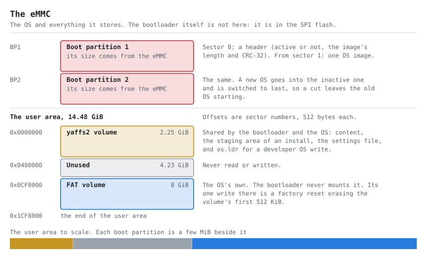

# Waffle Boot

An open-source bootloader for the Teenage Engineering OP-XY and OP-1 Field. It brings up the device's
processors, loads the OS from the eMMC, and adds its own menus for installs, settings and recovery. Support
for the OP-1 Field is initial.

## Status

This project is still in heavy development. While it is working on the maintainer's units, there is still much to do to make the overall experience more friendly. See
[Status and Roadmap](https://github.com/bagofwaffles/waffle-boot/wiki/Status-and-Roadmap) for what has
been run on each device, open work and what is out of scope.

## Why use waffle-boot?

- **Upgrade or downgrade.** Install the firmware version you choose, older or newer, or a
  [package with your own OS image](https://github.com/bagofwaffles/waffle-boot/wiki/Building-Custom-OS-Updates).
- **For developers.** MTP file transfer, a log over USB, and a way to script changes from a computer. See
  the [Developer Host Link](https://github.com/bagofwaffles/waffle-boot/wiki/Developer-Host-Link).
- **Recovery options.** Several [failsafes](https://github.com/bagofwaffles/waffle-boot/wiki/How-to-Recover) bring a unit back
  over USB, and they run apart from the rest of the code.
- **Open source.** The code is here to read, build and change.

waffle-boot is a clean-room implementation, not a decompilation. Its code is written from scratch, from
public documentation and the project's own functional specification, and the repository holds no
code or data from the device's firmware. It is an independent project, not affiliated with or endorsed by
Teenage Engineering.

> [!WARNING]
> Under development. Use it with caution. The installer has been tested
> on real hardware, but not widely. A broken bootloader can leave a unit that only an external flash
> programmer brings back.

**Install with the guided page: https://bagofwaffles.github.io/waffle-boot/?mode=install** (OP-XY). An
OP-1 Field takes its installer by the unit's own OS write: see
[How to Install](https://github.com/bagofwaffles/waffle-boot/wiki/How-to-Install).


## Where things are stored

Everything the unit needs to start is in a 1 MiB SPI flash: the first stage, a few sectors of tables, and
the two slots that hold the bootloader. The first stage is fitted at manufacture and is not part of
waffle-boot. The OS and everything it stores are on the eMMC.

[What is written to the SPI flash](https://github.com/bagofwaffles/waffle-boot/wiki/Flash-Layout-and-Write-Safety) lists every area, the rules that keep a write from
leaving a unit that does not start, and the few writes those rules do not cover.

<picture>
  <source media="(prefers-color-scheme: dark)" srcset="docs/maps/spi-flash-dark.svg">
  
</picture>

<picture>
  <source media="(prefers-color-scheme: dark)" srcset="docs/maps/emmc-dark.svg">
  
</picture>

## Documentation

The documentation is the [wiki](https://github.com/bagofwaffles/waffle-boot/wiki/). Start with:

- [How to Install](https://github.com/bagofwaffles/waffle-boot/wiki/How-to-Install): putting waffle-boot on a unit with the installer and
  [the browser page](https://bagofwaffles.github.io/waffle-boot/)
- [How to Recover](https://github.com/bagofwaffles/waffle-boot/wiki/How-to-Recover): the recovery menu, and what to do when the unit will not start

Using it: the [Boot Menu](https://github.com/bagofwaffles/waffle-boot/wiki/Boot-Menu), [Updating the OS](https://github.com/bagofwaffles/waffle-boot/wiki/Updating-the-OS) from the boot menu, and
[Getting Logs Off the Unit](https://github.com/bagofwaffles/waffle-boot/wiki/Getting-Logs-Off-the-Unit).

How it works: [Flash Layout and Write Safety](https://github.com/bagofwaffles/waffle-boot/wiki/Flash-Layout-and-Write-Safety),
[The Front](https://github.com/bagofwaffles/waffle-boot/wiki/The-Front) and its failsafes, the [Boot Chain](https://github.com/bagofwaffles/waffle-boot/wiki/Boot-Chain), the
[Screen Style Guide](https://github.com/bagofwaffles/waffle-boot/wiki/Screen-Style-Guide), and the [Requirement Labels](https://github.com/bagofwaffles/waffle-boot/wiki/Specification) the code and
tests cite.

Working on it: [Building and Testing](https://github.com/bagofwaffles/waffle-boot/wiki/Building-and-Testing) (with the source map), the
[Installer Reference](https://github.com/bagofwaffles/waffle-boot/wiki/Installer-Reference), the [Recovery Reference](https://github.com/bagofwaffles/waffle-boot/wiki/Recovery-Reference), the
[Test OS](https://github.com/bagofwaffles/waffle-boot/wiki/Test-OS) and the [Developer Host Link](https://github.com/bagofwaffles/waffle-boot/wiki/Developer-Host-Link).

Also in this repository: [Contributing](CONTRIBUTING.md), the clean-room rule (outside code contributions
are not open yet; bug reports are welcome), and [Security](SECURITY.md), how to report a problem privately.

## Build and test

On Linux, the host build and the tests need a C compiler, Python 3, git and GNU binutils. The cross
toolchain needs a little more, listed in [Building and Testing](https://github.com/bagofwaffles/waffle-boot/wiki/Building-and-Testing).

```sh
make check                  # host build and unit tests
tools/conformance.sh        # the conformance tests
tools/toolchain/build.sh    # the bfin-elf cross toolchain, built once
make cross                  # the image: build/bf703/waffle-boot.ldr
```

On macOS the toolchain and `make cross` work, but `make check` does not link. Use `tools/ci-local.sh`
there: it runs the checks in a Linux container (Docker). See
[Building and Testing](https://github.com/bagofwaffles/waffle-boot/wiki/Building-and-Testing).

## License

GPL-2.0-or-later ([`LICENSE`](LICENSE)). Vendored code keeps its own license, listed in
[`src/third_party/README.md`](src/third_party/README.md). OP-XY and OP-1 Field are trademarks of Teenage
Engineering.
