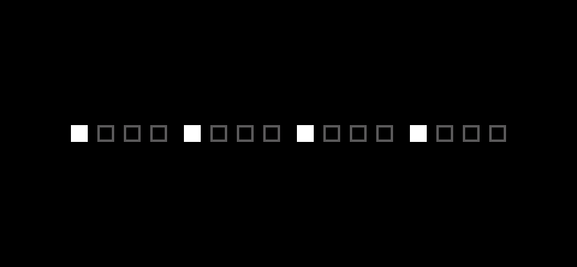
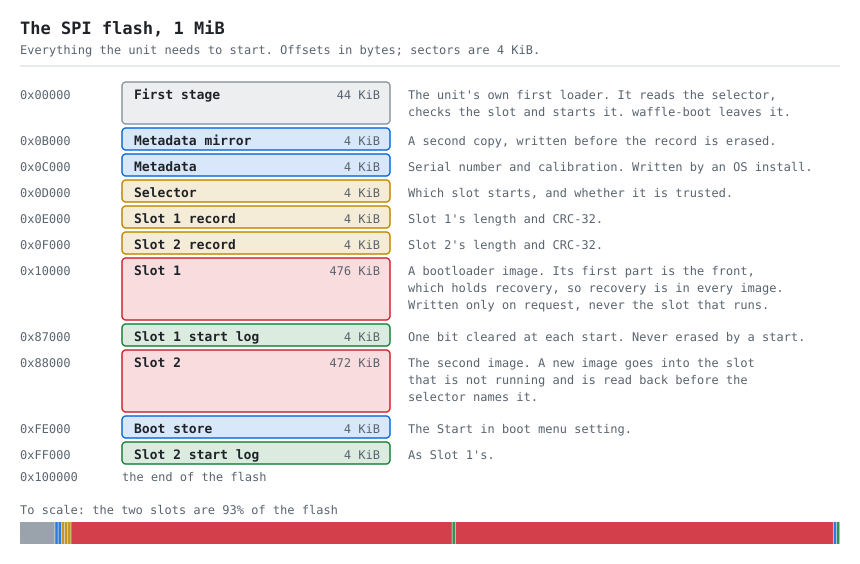

# waffle-boot

An open-source bootloader for the Teenage Engineering OP-XY. It brings up the device's two processors, loads
the OS from the eMMC, and adds its own menus for installs, settings and recovery.

waffle-boot is a clean-room implementation, not a decompilation. Its code is written from scratch, from
public documentation and the project's own functional specification, and the repository holds no
code or data from the device's firmware. It is an independent project, not affiliated with or endorsed by
Teenage Engineering.

> [!WARNING]
> **Under development. Use it with caution.** The [installer](https://github.com/bagofwaffles/waffle-boot/wiki/How-to-Install) has been tested
> on real hardware, but not widely. A broken bootloader can leave a unit that only an external flash
> programmer brings back.

Install with the guided page: https://bagofwaffles.github.io/waffle-boot/?mode=install

**Status:** it boots on one unit. Shown there so far: a start from a committed slot through to the OP-XY's
own OS, writing a slot over USB from recovery, and the trial and commit that the installer reuses.
[Status and roadmap](https://github.com/bagofwaffles/waffle-boot/wiki/Status-and-Roadmap) covers open work and what is out of scope.



## What it does

- **Boot menu.** Hold **com**, or the white knob, while switching the unit on. It installs firmware and
  holds the settings, device information, and a System screen with a key test, format and factory reset.
  Anything that erases asks first.
- **Recovery menu.** Hold **M4**, and no other key, while switching the unit on. From it you can try the
  other slot for one start, make the other slot the boot slot, or write a new image sent from a computer over USB.
  Recovery is part of the front, the small first part of every image, so it still runs when the rest of the
  image is damaged. It opens by itself when the rest of the image fails its check, or after three starts in
  a row that did not finish.
- **Developer menu.** Developer mode is a setting. With it on, the boot menu gains a developer menu, and
  the unit adds MTP file transfer to its storage and a USB serial port that carries the log and takes
  requests from a computer.
- **Firmware installs.** Choose Install firmware and the unit offers a USB disk. Copy a firmware package to
  it and eject it; the bootloader checks the package, then installs it. This is built, but not yet
  confirmed on a unit.
- **Diagnostics.** When the OS cannot be started, the boot menu opens by itself, and its main screen and
  Device Info say why.
- **Two slots, so a write has a way back.** The SPI flash holds two bootloader images, Slot 1 and Slot 2. A
  new image is written to the slot the unit is not starting from, read back, and only then selected, so a
  power cut before that leaves the unit starting as it did. A new slot is checked at its first start, and
  one that fails gives way to the other slot from the next start on.

## Where things are stored

Everything the unit needs to start is in a 1 MiB SPI flash: the first stage, a few sectors of tables, and
the two slots that hold the bootloader. The first stage is fitted at manufacture and is not part of
waffle-boot. The OS and everything it stores are on the eMMC.

[What is written to the SPI flash](https://github.com/bagofwaffles/waffle-boot/wiki/Flash-Layout-and-Write-Safety) lists every area, the rules that keep a write from
leaving a unit that does not start, and the few writes those rules do not cover.

<picture>
  <source media="(prefers-color-scheme: dark)" srcset="docs/maps/spi-flash-dark.svg">
  
</picture>

<picture>
  <source media="(prefers-color-scheme: dark)" srcset="docs/maps/emmc-dark.svg">
  
</picture>

## Documentation

The documentation is the [wiki](https://github.com/bagofwaffles/waffle-boot/wiki/). Start with:

- [How to Install](https://github.com/bagofwaffles/waffle-boot/wiki/How-to-Install): putting waffle-boot on a unit with the installer and
  [the browser page](https://bagofwaffles.github.io/waffle-boot/)
- [How to Recover](https://github.com/bagofwaffles/waffle-boot/wiki/How-to-Recover): the recovery menu, and what to do when the unit will not start

Using it: the [Boot Menu](https://github.com/bagofwaffles/waffle-boot/wiki/Boot-Menu), [Updating the OS](https://github.com/bagofwaffles/waffle-boot/wiki/Updating-the-OS) from the boot menu, and
[Getting Logs Off the Unit](https://github.com/bagofwaffles/waffle-boot/wiki/Getting-Logs-Off-the-Unit).

How it works: [Flash Layout and Write Safety](https://github.com/bagofwaffles/waffle-boot/wiki/Flash-Layout-and-Write-Safety),
[The Front](https://github.com/bagofwaffles/waffle-boot/wiki/The-Front) and its failsafes, the [Boot Chain](https://github.com/bagofwaffles/waffle-boot/wiki/Boot-Chain), the
[Screen Style Guide](https://github.com/bagofwaffles/waffle-boot/wiki/Screen-Style-Guide), and the [Requirement Labels](https://github.com/bagofwaffles/waffle-boot/wiki/Specification) the code and
tests cite.

Working on it: [Building and Testing](https://github.com/bagofwaffles/waffle-boot/wiki/Building-and-Testing) (with the source map), the
[Installer Reference](https://github.com/bagofwaffles/waffle-boot/wiki/Installer-Reference), the [Recovery Reference](https://github.com/bagofwaffles/waffle-boot/wiki/Recovery-Reference), the
[Test OS](https://github.com/bagofwaffles/waffle-boot/wiki/Test-OS) and the [Developer Host Link](https://github.com/bagofwaffles/waffle-boot/wiki/Developer-Host-Link).

Also in this repository: [Contributing](CONTRIBUTING.md), the clean-room rule (outside code contributions
are not open yet; bug reports are welcome), and [Security](SECURITY.md), how to report a problem privately.

## Build and test

On Linux, the host build and the tests need a C compiler, Python 3, git and GNU binutils. The cross
toolchain needs a little more, listed in [Building and Testing](https://github.com/bagofwaffles/waffle-boot/wiki/Building-and-Testing).

```sh
make check                  # host build and unit tests
tools/conformance.sh        # the conformance tests
tools/toolchain/build.sh    # the bfin-elf cross toolchain, built once
make cross                  # the image: build/bf703/waffle-boot.ldr
```

On macOS the toolchain and `make cross` work, but `make check` does not link. Use `tools/ci-local.sh`
there: it runs the checks in a Linux container (Docker). See
[Building and Testing](https://github.com/bagofwaffles/waffle-boot/wiki/Building-and-Testing).

## License

GPL-2.0-or-later ([`LICENSE`](LICENSE)). Vendored code keeps its own license, listed in
[`src/third_party/README.md`](src/third_party/README.md). OP-XY is a trademark of Teenage Engineering.
