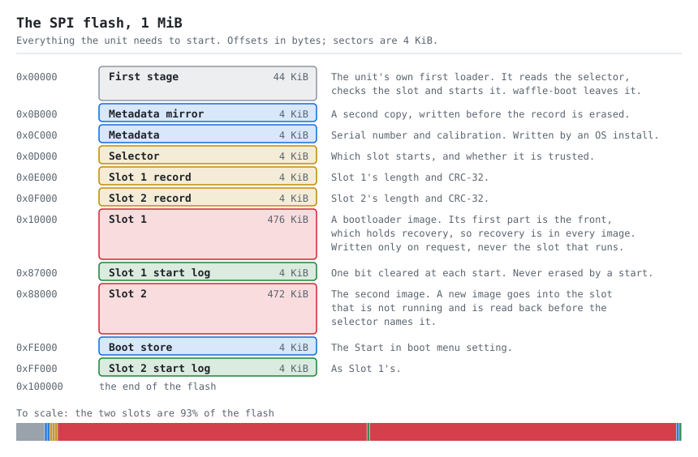

# What waffle-boot writes to the SPI flash

The master's 1 MiB SPI flash holds everything the unit needs to start. This page lists every area, who
writes it and when, the rules that keep a write from leaving a unit that does not start, and how often each
sector is erased. [`front.md`](front.md) covers the failsafes.

Sectors are 4 KiB, pages 256 bytes. An erase sets a sector to `0xFF`; a program can only clear bits.

## The areas

<picture>
  <source media="(prefers-color-scheme: dark)" srcset="maps/spi-flash-dark.svg">
  
</picture>

| Offset | Size | Holds | Written by | When |
| --- | --- | --- | --- | --- |
| `0x00000` | `0xB000` | The first stage | The package's first-stage step | Only with the session upgrade option on and the step confirmed on the unit |
| `0x0B000` | 1 sector | The metadata mirror: the record and its complement | Every metadata write | Before the record itself is erased |
| `0x0C000` | 1 sector | The metadata record (`0x34` bytes) | Metadata writes; the restore at a start | An OS install (three times), a failed OS load (once), a set-metadata request in factory mode; a start that finds the mirror and the record different |
| `0x0D000` | 1 sector | The selector: the slot to start, and `verified` | The first stage; a slot write; recovery's try, switch and keep | After a slot has been read back; once by the first stage at the start after it |
| `0x0E000`, `0x0F000` | 1 sector each | A slot's record: CRC-32, length, tag | A write of that slot; recovery's try, keep and put back | After the slot's last program |
| `0x10000` | `0x77000` | Slot 1's image | The package's bootloader step; recovery; the test OS installer | On request only |
| `0x87000` | 1 sector | Slot 1's start log | The front and the main image; a slot write erases it | One bit at each start, a second when the main image is up |
| `0x88000` | `0x76000` | Slot 2's image | As Slot 1 | On request only |
| `0xFE000` | 1 sector | The boot store: Start in boot menu | The Settings screen | When the setting is changed |
| `0xFF000` | 1 sector | Slot 2's start log | As Slot 1's | As Slot 1's |

Which writer takes which size: the package's bootloader step takes an image of up to `0x78000` bytes, the
whole slot (S-02.044); recovery and the test OS installer take at most `0x77000` bytes, which leaves the
slot's last sector to the start log (S-02.084, S-02.095). `wbrecover.py` checks the image against recovery's
limit. In a slot, an image over `0x77000` bytes covers its slot's start log, which is then
not used; one over `0x76000` bytes in Slot 2 covers the boot store, which is then off. waffle-boot's own
build is at most `0x76000` bytes. A write of Slot 2 with such an image leaves the boot store as it is.

A normal start erases nothing. It programs two bits, in the last sector of the slot the selector names.

## The rules

**One accessor.** Only the master touches the flash, through one driver in the front and one in the main
image. Each checks that an erase is one whole sector and a program stays inside one page, both inside the
flash. Every erase and program is preceded by a write enable and followed by a wait until the part is no
longer busy, bounded at 2 s. A part that stays busy fails the operation.

**A footprint for each writer.** Recovery can reach only the slot it writes, that slot's record and the
selector. The boot store's save can reach only its own sector. A metadata write reaches only the mirror and
the record. Nothing but the first-stage step, behind the session upgrade option and a confirmation on the
unit, writes below `0xB000`.

**The slot the unit starts from is not written.** A write goes to the slot the selector does not name. It
starts only when the selector reads `verified` = `0x01` and, for a package step, the selected slot reads
good.

**One order.** The image, the slot's last sector, the record's erase, the record, a read-back of the whole
slot, and only then the selector. A failure anywhere before the selector leaves the selector as it was. A
power cut before the selector's erase leaves the unit starting as before; from that erase on both slots are
good, so any selector value starts a good one.

**Both slots may hold the same image.** No writer refuses the image a slot already holds. The front and
the main image then count as the running slot the one the unit goes on starting, so the slot a write keeps
is the one a start after a power cut runs.

**Checked before the first erase.** The image's size, that it is a stream the boot ROM can start and, in
recovery, its SHA-256 and its front. Recovery reads the selector and both slots again at that moment.

**The start log never erases.** Each start clears one bit and reads it back. Any state of the sector either
starts the main image or opens recovery once.

**Metadata keeps two copies.** The mirror is written and read back before the record is erased. The mirror
counts only when every byte matches its complement, so a cut leaves the old record or the new one.

**The boot store is either whole or the default.** A save is refused while Slot 2's record shows an image
that could reach the sector. A cut leaves the old value or the default.

**Destructive requests are confirmed.** The host tool asks for a typed phrase; the unit then counts down
15 s, and switching it off in that time leaves the flash untouched. On the unit, an action needs key 1 held
for 5 s.

## What is not safe against a power cut

- A write of the first stage: a cut leaves nothing that starts.
- Recovery's in-place write of the running slot, which is taken only when the other slot is bad.
- A trial of another front: two short moments in which a cut can leave the tried slot trusted before its
  front has run.

`docs/front.md` describes each of them and what narrows it.

## Wear

Serial NOR flash is usually rated for 100,000 erase cycles per sector. The part on the board is not
identified, so its own figure is not known.

| Action | Sector erases | Where |
| --- | --- | --- |
| A normal start | 0 | Two one-bit programs in the selected slot's last sector |
| Start in boot menu changed | 1 | `0xFE000` |
| Any other setting changed | 0 | Kept in a file on the eMMC |
| Session upgrade option turned on | 0 | Kept in memory only |
| Install, content only | 0 | None |
| Install with an OS | 6 | `0xB000` and `0xC000`, three times each |
| An install that was interrupted, at the next start | 2 | `0xB000`, `0xC000` |
| A bootloader image written (package or recovery) | One for each 4 KiB of the image, plus the slot's last sector, its record and the selector; one more of the selector by the first stage at the next start | The slot written, its record, `0xD000` |
| Try a slot once | Up to 3, and 1 by the first stage | The slot's last sector, its record, `0xD000` |
| Switch slots | 1, and 1 by the first stage | `0xD000` |
| Keep a tried slot | 2, and 1 by the first stage | Its record, `0xD000` |

The selector's sector is the most used: two or three erases for each bootloader change, so tens of
thousands of changes. Metadata lasts for tens of thousands of OS installs. No sector is erased at a start
or on a timer, and no log or counter shares a sector with the selector, a record, the metadata or the first
stage.

A start log holds 16,384 starts. When it is full the front stops counting starts in it, and three unfinished
starts do not open recovery by themselves; Power + M4 still does. Writing that slot again empties it.

Reading does not wear the flash.

## The eMMC

A normal start writes nothing to the eMMC and mounts no volume. Opening the boot menu and leaving it writes
nothing. A changed setting writes a small file to a new name and renames it over the old one, so the file is
the old one or the new one. An OS install writes the boot partition that is not in use and switches to it
last. Whatever the eMMC holds, the bootloader starts from the SPI flash and reaches its boot menu.
