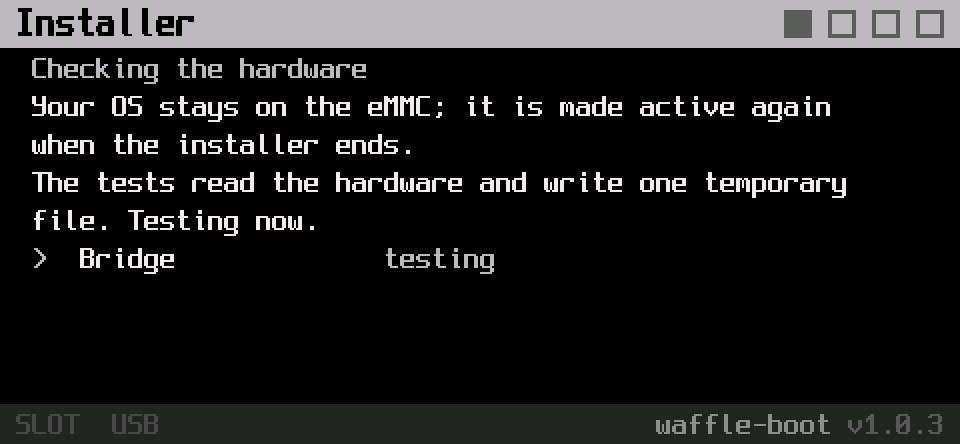
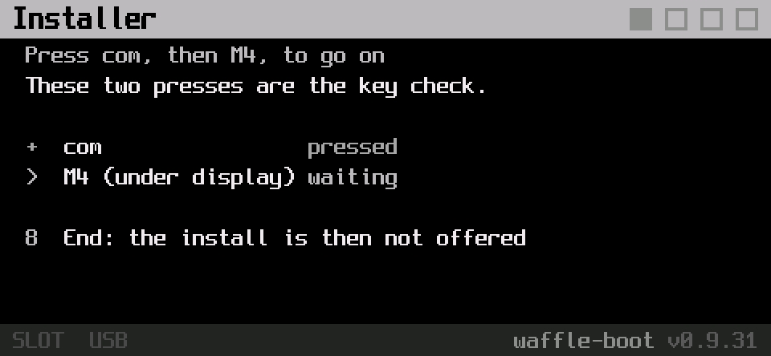
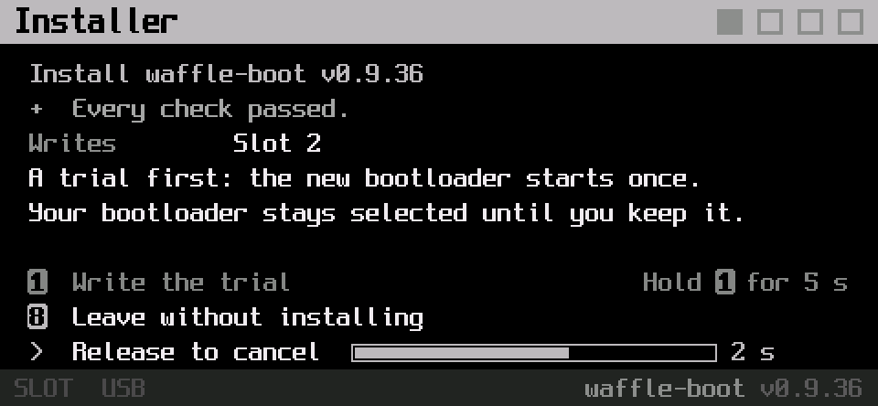
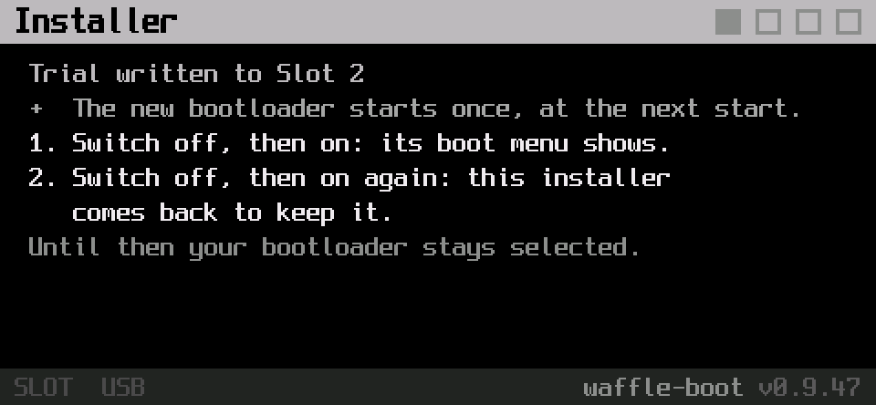
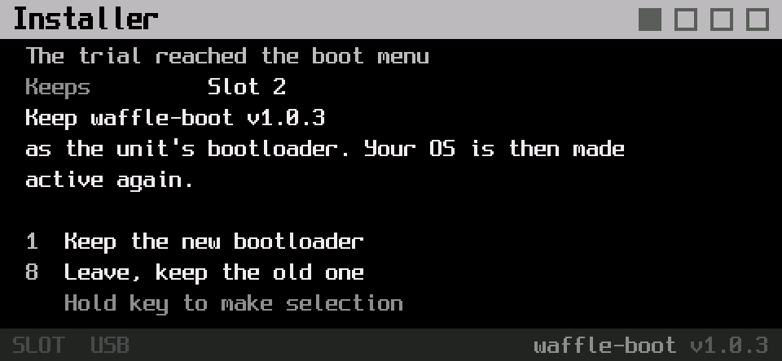
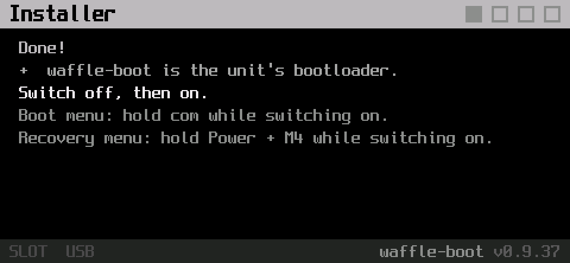
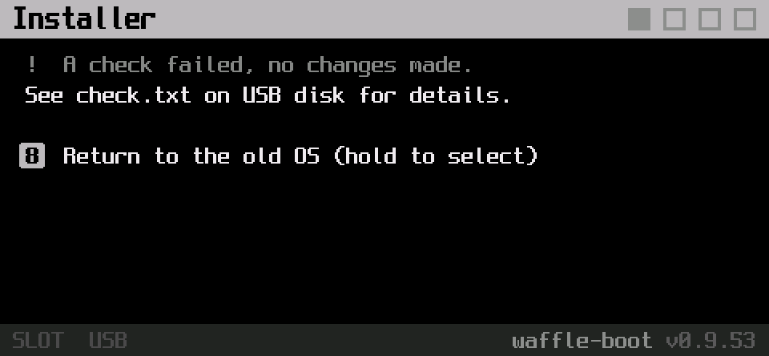

# Installing waffle-boot

> **Under development.** The installer has been tested on real hardware, but not widely: use it with caution.
> A broken bootloader can leave a unit that only an external flash programmer brings back.

The installer is one file, `waffle-install.ldr`. It runs as the unit's OS under whatever bootloader the unit
has, checks the hardware, and only when every check passes it writes the waffle-boot image it carries.
Every write is started on the unit, by holding the step's key for 5 s. The
[recovery page](recover/) guides each step from a computer and shows the checks as they run; the only thing
it sends is the installer file, to a unit already on waffle-boot (step 1).

## Before you start

- The bootloader on the unit must have a developer menu that writes an OS file to the boot partition the OS
  is not in. A unit that has never had developer mode on needs it turned on first, with the [ferret tool](https://bagofwaffles.github.io/ferret/op-xy/);
  this project does nothing for that step.
- Your OS stays on the eMMC. The installer is written into the other boot partition, and the installer makes
  your OS active again when it ends.
- Charge the unit, and keep it on USB while it writes.

## The steps

1. **Write the installer from the developer menu.** Copy `waffle-install.ldr` to the unit and write it as
   the OS from the developer menu, then switch off and on. The installer starts. On a unit already on
   waffle-boot with developer mode on, the recovery page's Install tab can send the file instead, over the
   boot menu's USB serial port, as `/yaffs2/os.ldr` (as `tools/testos_mon.py dev-put` does), and checks its
   size and SHA-256; then press 5 in the developer menu, Write /os.ldr to boot partition.
2. **The checks.** It tests the clocks and DDR, the SPI flash, the PSoC, the second processor and the
   bridge, the eMMC, the display, the clock and the Nordic chip, then asks for one guided step: press com, then
   M4 (4 under the display). That is the key check, and reading the screen shows the panel works. 8 ends it,
   and the install is then not offered; after a trial start it is not asked again. USB is shown by the page
   connecting at all.
   The results are on the screen, on the page, and in `check.txt` on the unit's USB disk (no serial number
   or key).

    
3. **The trial.** When every check passes, the unit shows the version it carries and the slot it will
   write. Hold **1** for 5 s. It writes the slot the selector does not name, for one start only; your
   bootloader stays selected.

   
4. **The trial start.** Switch off, then on. The new bootloader starts once and its boot menu shows: that
   start marks the trial as having reached the boot menu. Switch off, then on again: your old bootloader
   starts the installer again.

   
5. **Keep it.** The installer shows that the trial reached the boot menu. Hold **1** for 5 s. It makes the
   new slot the one the unit starts, then makes your OS active again.

   
6. **Done.** Switch off, then on: waffle-boot starts your OS. The recovery menu is Power + M4 (4 under the display).

   

Holding **8** for 5 s on any of these screens leaves without installing and makes your OS active again.

## When something does not pass

| The unit shows | It means | What to do |
| --- | --- | --- |
| The install is not offered | A check failed or could not run, or the carried image did not pass its check. Nothing was written to the SPI flash | Read `check.txt`. Hold 8 to make your OS active again. A wrong check is fixed in the installer, not overridden |
| The trial did not reach the boot menu | The trial start ran, or did not run, the new bootloader, but its boot menu did not show | Nothing was kept. Hold 1 to write the trial again, or 8 to leave |
| The write did not complete | A write or its read-back failed | The unit keeps a bootloader that starts. Hold 1 to try again, or 8 to leave |

## What it writes

- **Before the trial:** nothing. It reads the selector, both slots and the boot partitions' headers, and
  checks the image it carries: its CRC-32, that it is a stream the unit can start, its descriptor, and its
  front against the pinned front (`src/front/front.pin`).
- **The trial:** the slot the selector does not name, that slot's record with the trial mark (the CRC
  inverted, so the first stage starts it once), byte 0 of its start log `0xFD` (a trial pending), and the
  selector naming that slot unverified. The way back is the old slot, untouched: a power cut at any point
  leaves a selected slot that starts. This is the write the earlier, host-driven installer made, unchanged.
- **The trial start:** the new slot's front marks the start (`0xFD` to `0xFC`), and its main image marks
  the boot menu reached (`0xFC` to `0xF0`, entry 1 of the log finished, S-02.095). Nothing else.
- **The commit:** only after both marks: the record with the right CRC, then the selector `{slot, 0x00}`.
  Then the active byte of the two boot partitions' headers, your OS's first.
- **Never:** the first stage, the metadata, or the slot the selector names.

A breadcrumb build (`BOOT_CRUMBS=1`) runs only as a trial: the commit is refused, and `check.txt` lists its
marks, which `tools/testos_mon.py crumbs` decodes.

## Building it

    make bump-version
    make installer

`build/waffle-install.ldr` carries this build's `build/bf703/waffle-boot.ldr`. The build fails unless that
image is a bootloader stream whose descriptor carries the pinned front.

## The installer's USB protocol

The installer offers its RAM disk and one USB serial port (vendor `0x2367`, product `0x0021`). On the port it
answers requests and changes nothing: there is no request that writes.

Every frame is recovery's (S-02.093): `57 52` ("WR"), a type (u8), a sequence number (u8), the payload's
length (u16), the payload, and the CRC-32 of S-02.015 over the type to the payload's end (u32), all
little-endian; a payload is at most 1032 bytes. A reply has the request's type with bit 7 set and its
sequence number. Bytes that make no whole frame with a good CRC are dropped up to the next `57 52`. No
request is read while a reply waits. The page already has this codec, and the types below never meet
recovery's (`0x01` to `0x07`), which the installer answers with the payload `FF`.

While it writes, and in some long checks, the installer does not service the port for up to about 30 s.

| Type | Request | Reply |
| --- | --- | --- |
| `0x40` HELLO | none | 64 bytes: `WBIN`, protocol version (1), phase, flags, the number of tests, the carried image's version (4 × u16), length (u32), CRC-32 (u32), front pin (32 bytes), 8 zeros |
| `0x41` STATE | none | 32 bytes, then each test's state (u8): 0 phase, 1 flags, 2 verdict (0 pass, 1 pass with gaps, 2 fail, `FF` not yet), 3 the test under way (`FF` none), 4 the lock, 5 and 6 the selector, 7 and 8 each slot's state, 9 the target slot (`FF` none), 10 the last write's code (`FF` none), 11 the OS partition, 12 the hold's progress (u16, 0 to 1000), 14 the key held (digit), 15 the trial, 16 the key of the next step (1, or 0), the rest zeros |
| `0x42` TEST | the test's index (u8) | status (0, or 1 for no such test), index, state, kind (0 OS, 1 automatic, 2 guided), then four NUL-ended strings: its id, its name, the detail line (at most 56 characters) and the report's note (at most 160) |
| `0x43` REPORT | an offset (u32) | status (0), `check.txt`'s length (u32), then up to 1024 of its bytes from the offset. The text is rewritten as the checks run, so a reader starts again when the length changes |

- **Phase:** 0 starting, 1 checking, 2 the key check, 3 locked, 4 ready (the trial offered), 5 writing the
  trial, 6 the trial written, 7 the commit offered, 8 committing, 9 done, 10 a write failed, 11 the trial
  failed, 12 left without installing.
- **Flags:** bit 0 the checks done, bit 1 the install offered, bit 2 the carried image passed its check, bit 3
  a breadcrumb build.
- **Lock:** 0 none, 1 a check failed, 2 a check could not run, 3 the carried image, 4 the selected slot not
  verified or not good, 5 the unit's OS not found or bad, 6 the key check ended with 8, 7 the eMMC not
  reachable.
- **Slot state:** bit 0 good, 1 this image under the trial mark, 2 this image committed, 3 trial pending, 4
  trial started, 5 trial spent, 6 trial entry odd, 7 the trial reached the boot menu.
- **OS partition:** 0 not looked at, 1 found and checked, 2 found, stored encrypted, 3 not found, 4 fails its
  check, 5 not read, 6 active again, 7 could not be made active again. Hold 8 is offered while it is 1 or 2.
- **Trial:** 0 none, 1 written, 2 reached the boot menu, 3 started without reaching it, 4 used up without a
  start of the new bootloader.
- **Write codes:** S-02's (2 I/O, 3 size, 4 verify, 5 start, 6 not good, 7 not a bootable stream), `40` a
  breadcrumb build's commit, `41` the trial not started, `43` the carried image, `44` the boot menu not
  reached.

`src/testos/installer_logic.c` is the reference, `tests/unit/test_board_installer.c` holds frames byte for
byte, and `docs/recover/install.js` reads them.
