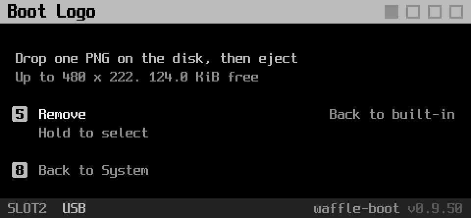
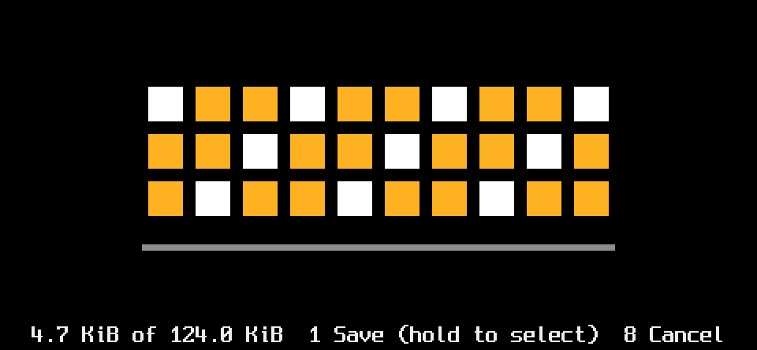

Your own picture in place of the built-in logo, from the first frame of every start to the OS's own
screen. It is kept in the SPI flash with the image of the slot the unit runs, like the settings, and a
firmware install removes it.

 

## Putting one on

1. Open the boot menu, then **5 System** and **6 Boot logo**. The unit offers an empty USB disk.
2. Copy **one** PNG file to the disk and eject it. Files whose names start with a dot (a computer adds
   some) are left alone; anything that is not a `.png` is ignored.
3. About 2 s later the unit shows the picture as the start will show it, with its size and the free space
   on the last line. **Hold 1 for 5 s** to save it, or press **8** to try another file.

The next start shows it. Nothing is written until the hold ends; releasing 1 early, or any other key,
saves nothing.

## The picture

- Not interlaced, at most 480 x 222 pixels: gray (1, 2, 4 or 8 bits), gray with alpha, RGB or RGBA
  (8 bits), or a palette (1, 2, 4 or 8 bits). 16-bit PNGs are refused: save at 8 bits.
- A smaller picture is centered, on the color of its top-left pixel. Nothing is scaled.
- Colors become the panel's (5 bits of red, 6 of green, 5 of blue); a translucent pixel is blended onto black.
- With 256 colors or fewer, the picture keeps its colors. With more, they are reduced to 256. If that does
  not fit, to 16 with dithering. If that does not fit either, nothing is saved and the screen says how big
  it was.
- It is stored as runs of one color, so flat areas cost little; photos and gradients cost the most.
  `tools/wblogo.py encode PICTURE.png OUT.bin --room BYTES` converts it on a computer exactly as the unit
  does, and says how many bytes it takes.
- A larger PNG may show a little more slowly at start: the start reads the stored picture whole before
  its first frame.

## How much room

The picture goes in the free part of the slot, between the end of the bootloader image and the slot's
settings sector ([Flash Layout](Flash-Layout-and-Write-Safety#the-areas)), so the room depends on the
image's size. The Boot Logo screen and Device Info 2 (`Boot logo`) show it. An image that reaches that sector
leaves none, and the item shows `No room`.

## Removing it

**5 System**, **6 Boot logo**, then **hold 5 for 5 s** (`Remove`). The next start shows the built-in logo. A
factory reset (System, 7) removes it too, with the settings. Installing
firmware to a slot (with the installer, recovery, `wbrecover.py`, the browser page or an install from the
boot menu) removes that slot's picture as well; each slot keeps its own, and nothing carries over.

## When it is not shown

The start shows the built-in logo whenever anything about the stored picture is not right: no picture, one
saved for another image, a damaged one, or one that does not fit the slot's room. The start reads and
checks it whole once, before its first frame; the recovery menu (Power + M4) does not use it: `Loading recovery menu...` is drawn under whichever
logo the start showed, and recovery's own screens are its own.

Saving follows the settings' rule: only a key on the unit saves, never a key a computer sends, and only on a
start of a slot whose image passed its check. A trial start of a new image saves nothing.
