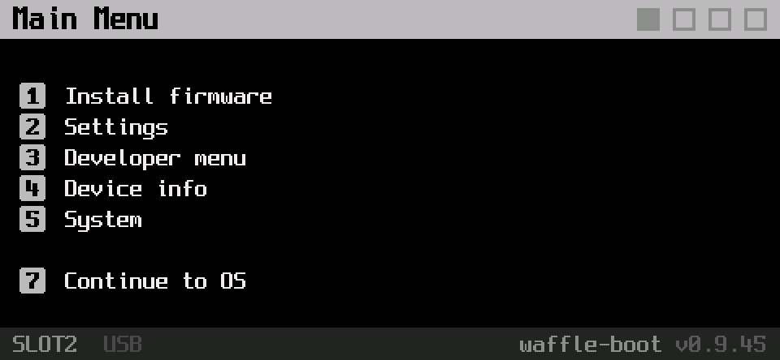
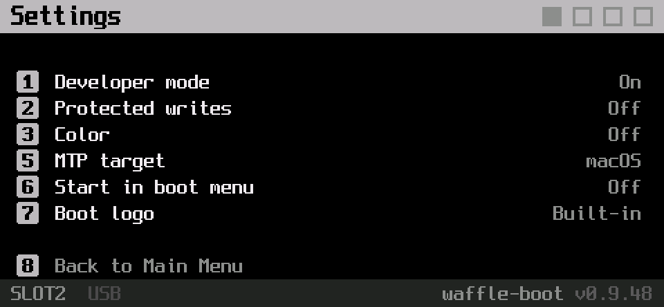
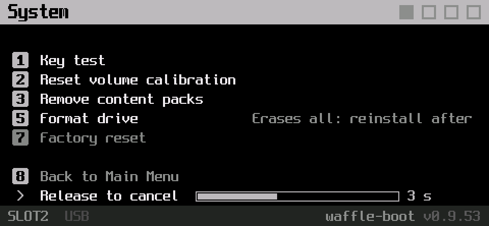

The boot menu is waffle-boot's own set of screens, shown instead of starting the OS. (The code calls it
**held mode**.) For the red recovery screens, opened by Power + M4, see [How to Recover](How-to-Recover).

## Opening it

- **Hold com, or press and hold the white knob (knob 4), while you switch the unit on.** Keep holding until
  `Loading boot menu...` appears under the logo, then let go: the menu follows a few seconds later. Keys
  pressed while the line shows do nothing, and a key still held when the menu opens does nothing until let
  go and pressed again.
- **Settings → 6 Start in boot menu: On.** Every start then opens the menu instead of the OS, but the one
  start after Continue to the OS or after the developer menu's 3 Start /os.ldr once (does not write).
- **By itself**, when the OS cannot be started, when the last install did not finish, or when the OS
  restarts the unit into the bootloader for an update.

While `Loading boot menu...` shows, the bootloader mounts the file volume on the eMMC read only from the
OS's checkpoint, and checks every block against it; on any doubt it scans the volume instead, which takes
longer. It never writes a checkpoint. Device Info 2's `Files` row says which it did and why. The first write
of a session to the volume (Install firmware, MTP on, a host's file transfer, a factory reset, a content
pack's removal) scans first, under `Checking files...`. A format and a settings change need no scan.

## Keys

Items are chosen by digit. Digits 1 to 4 are M1 to M4, the knob 1 to 4 clicks, or sound keys 1 to 4.
Digits 5 to 8 are sound keys 5 to 8 only. **8 goes back** on every screen below the main one.

Whatever erases asks first: press and hold the item's own key. Its row turns red with `Hold 7 for 5 s` (its
digit), and a bar fills along the bottom row. Held for 5 s, it runs once; letting go earlier, or any other
key, cancels. A knob click never starts it.

## Main Menu

| Item | What it does |
| --- | --- |
| 1 Install firmware | Offers a USB disk for a firmware package ([Updating the OS](Updating-the-OS)). Once the package is checked, the unit lists its parts: choose them with their digits and hold 1 for 5 s, or cancel with 8; after a cancel 8 goes back here. Hold **shift** while pressing 1 to also copy system information and logs to the disk ([Getting Logs Off the Unit](Getting-Logs-Off-the-Unit)) |
| 2 Settings | The settings below |
| 3 Developer menu | Shown only while developer mode is on |
| 4 Device info | Serial numbers, versions, the second processor's state, and why the OS did not start. The help key opens it too. Its `1 More` opens a second page: the selected slot's start log, with the starts it holds, the unfinished ones at its end and the count it is erased at, read again each time the page opens, and the boot logo: built-in or custom, and the bytes this image leaves for one |
| 5 System | Key test, volume calibration, content packs, format, factory reset |
| 7 Continue to OS | At the bottom, apart from the others. Restarts the unit into the OS from the eMMC's boot partition, also with Start in boot menu on. Nothing is written. With DSP2 not answering, the restart is the one that restarts DSP2 too, after which Start in boot menu applies |

The status bar shows the running slot (`SLOT1` or `SLOT2`) and `USB`, lit while a disk is offered. Under
the items, the screen says when the OS could not be started, and why.

## Settings

| Item | What it does |
| --- | --- |
| 1 Developer mode | Off by default. On: shows the developer menu and adds a USB serial port |
| 2 Protected writes | Lets installs write the bootloader slots (the list of parts offers the bootloader only while it is on), and lets a computer change the unit's serial and identity. 2 opens its screen, which says what it allows; hold 2 there for 5 s to turn it on. While it is on, 2 turns it off. Lasts until the next restart. No install writes the first stage, with or without it |
| 3 Color | Off, the default, draws every screen in gray |
| 5 MTP target | macOS or Windows: which MTP interface the developer menu offers |
| 6 Start in boot menu | Every start opens this menu |
| 7 Boot logo | Your own picture at the start in place of the built-in logo ([Boot Logo](Boot-Logo)). Its state: `Built-in`, `Custom`, `No room` when this image leaves no room for one, `Unavailable` when this start may not save one (as for the settings) |

### Where they are kept

All four are kept in the SPI flash, in the settings sector of the slot the unit is running
([Flash Layout](Flash-Layout-and-Write-Safety#the-areas)), and belong to that slot's image: the other slot
has its own, and a new image starts on the defaults (Developer mode off, Color off, MTP target macOS, Start in
boot menu off). A change is saved at once, and only by a key pressed on the unit. A key a computer sends
(a developer request) changes Developer mode, Color or the MTP target until the next start and saves
nothing, and leaves Start in boot menu as it is. Nothing is written to the internal drive: a format leaves
the settings, and a settings file on the drive (`bootloader.settings`) is not read or written.

When a change cannot be saved, Settings says why. Developer mode, Color and the MTP target keep their new state
until the next start; Start in boot menu shows what the next start will read.

| Message | Meaning |
| --- | --- |
| `Not saved: flash write failed` | The write failed |
| `Not saved: slot can't keep settings` | The running slot's image is over `0x76000` bytes and fills the settings sector, or this start is a trial start, or the running slot is not known |
| `Not saved: set from the computer` | The key came from a computer |

## System

| Item | What it does |
| --- | --- |
| 1 Key test | Press every key and knob. **Shift + 8** leaves it |
| 2 Reset volume calibration | Resets the volume knob's calibration, then returns to the main menu |
| 3 Remove content packs | Shown when packs are installed. Hold a pack's digit for 5 s to remove it |
| 5 Format drive | Erases the whole internal drive. Hold M1 or sound key 1 for 5 s. After the format the unit opens **Install Firmware** |
| 7 Factory reset | Removes user data ([below](#factory-reset)) |

### Factory reset

Removes your user data. A factory reset always asks for confirmation: its key held for 5 s.

> **Warning.** This cannot be undone. Copy anything you want to keep first.

It removes:

- the folders `user`, `logs` and `content/dlc` (installed content packs) on the internal drive;
- the start of the OS's own FAT volume on the eMMC;
- the running slot's settings, which return to their defaults.

It keeps the bootloader and the OS. It does not restart the
unit. To erase everything instead, use **5 Format drive**.

1. Charge the unit, or keep it on USB.
2. Open the boot menu: hold **com** or the white knob while you switch on.
3. Press **5** (sound key 5): **System**.
4. Press and hold **7** (sound key 7). The **Factory reset** row turns red, shows `Hold 7 for 5 s`, and a
   bar fills along the bottom row.
5. Keep holding for 5 s; the reset starts then. Letting go earlier, or pressing any other key, cancels and
   nothing is removed.
6. Wait for `User data removed. Restart the OP-XY.`
7. Switch the unit off and on.

| Message | Meaning |
| --- | --- |
| `Not removed: drive unreadable` | The drive cannot be read. Nothing was removed. A format erases it |
| `Not removed: DSP2 not answering` | The second processor stopped. Switch off and on, then try again |
| `Some user data not removed` | Part of it stayed. Switch off and on, then try again |
| `Settings not cleared: flash write failed` | The settings stayed as they were. Try the reset again |

## Developer menu

| Item | What it does |
| --- | --- |
| 2 MTP file transfer | Shares the internal drive with the computer, which can copy, delete, move and rename files and folders on it. 8 turns it off |
| 3 Start /os.ldr once (does not write) | Restarts the unit, and that one start loads the OS from the file `os.ldr` on the drive instead of the eMMC's boot partition, also with Start in boot menu on. Nothing is written to the eMMC; the start after it loads from the boot partition as before. Without a usable file, or with DSP2 not answering, it does not restart and says why; a file that fails at the start opens the boot menu with the reason |
| 5 Write /os.ldr to boot partition | Writes the file `os.ldr` from the drive to the eMMC's inactive boot partition. After a success, 6 restarts into the OS |
| 6 Restart | Restarts the unit |
