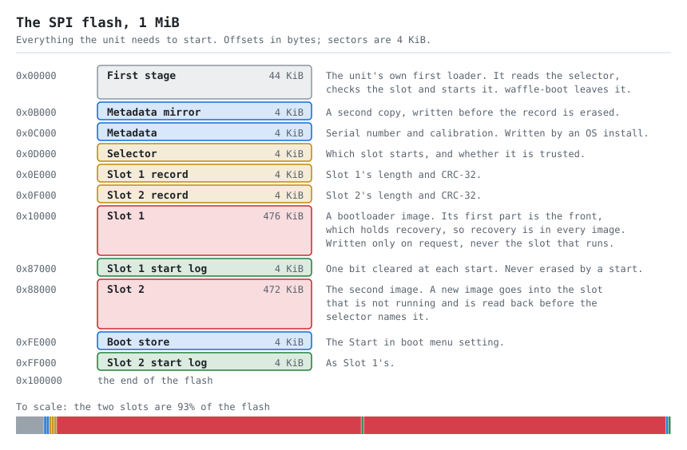
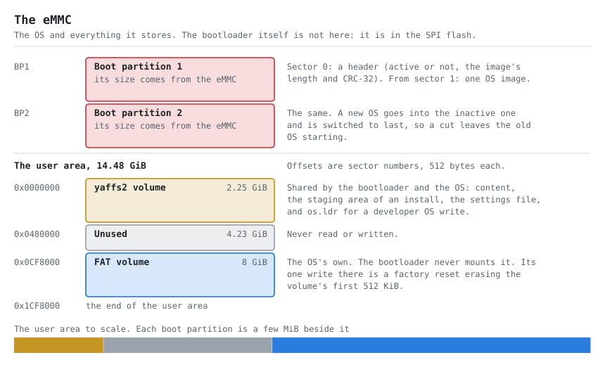

What waffle-boot writes to the SPI flash, and the rules that keep a write from leaving a unit that does not
start. Labels: S-02. Read this before changing anything that erases or programs the flash; the front's own
failsafes are in [The Front](The-Front#the-failsafes).

The master's SPI flash holds everything the unit needs to start: 1 MiB in 256 sectors of 4 KiB, pages of
256 bytes. An erase sets a sector to `0xFF`; a program can only clear bits.

## The areas

<picture>
  <source media="(prefers-color-scheme: dark)" srcset="../docs/maps/spi-flash-dark.svg">
  
</picture>

| Offset | Size | Holds | Written by | When |
| --- | --- | --- | --- | --- |
| `0x00000` | `0xB000` | The first stage, which picks a slot on every start. Not part of waffle-boot | Nothing: the installer has no first-stage step | Never. A first-stage file in a package is no component: it is not checked, and nothing writes it |
| `0x0B000` | 1 sector | The metadata mirror: the record and its complement | Every metadata write | Written before the record is erased, and erased once the record reads back |
| `0x0C000` | 1 sector | The metadata record (`0x34` bytes): serial, versions and install state | Metadata writes; the restore at a start | An install that writes the OS (three times), any other install but a content-only one or a canceled one (twice), a failed OS load (once), a set-metadata request in factory mode; a start that finds the mirror and the record different |
| `0x0D000` | 1 sector | The selector: the slot to start, and `verified` (`0x01` means "start it without a check") | The first stage; a slot write; recovery's try, switch and keep | After a slot has been read back; once by the first stage at the start after it |
| `0x0E000`, `0x0F000` | 1 sector each | Record 0 and record 1, one per slot: the image's CRC-32, its length and a tag | A write of that slot; recovery's try, keep and put back | After the slot's last program |
| `0x10000` | `0x76000` | Slot 1's image | The package's bootloader step; recovery; the installer | On request only: for a package, with Protected writes on and the bootloader chosen on the unit |
| `0x86000` | 1 sector | Slot 1's settings: Developer mode, Color, MTP target, Start in boot menu, Host link | The Settings screen; the factory reset; a slot write erases it | One page when a setting is changed on the unit, an erase once in 16 changes; the factory reset erases it |
| `0x87000` | 1 sector | Slot 1's start log | The front and the main image; a slot write erases it | One bit at each start, a second when the main image is up; in a trial start, the front's mark and the boot menu's. The main image erases it once 256 or more entries are used, and when it reads full or not valid |
| `0x88000` | `0x76000` | Slot 2's image | As Slot 1 | On request only |
| `0xFE000` | 1 sector | Slot 2's settings | As Slot 1's | As Slot 1's |
| `0xFF000` | 1 sector | Slot 2's start log | As Slot 1's | As Slot 1's |

The code numbers the slots 0 and 1; screens show them as Slot 1 and Slot 2.

Which writer takes which size: the package's bootloader step takes an image of up to `0x78000` bytes, the
whole slot (S-02.044). waffle-boot's own writers take at most `0x76000` bytes, which leaves the slot's last two
sectors to its settings and its start log (S-02.104): the installer, `wbrecover.py` and waffle-boot's own build
(`make cross`) refuse a longer image, and so does recovery in the front (a front before version 17 takes up
to `0x77000` bytes). A slot whose image is
longer than `0x76000` bytes has its settings sector filled with image bytes: it has no settings, every one reads
at its default, and a save is refused. Over `0x77000` bytes it has no start log either.

A normal start programs two bits, in the last sector of the slot the selector names, and erases nothing but
that sector, when the main image finds its log due (below). A trial start programs two bits too, in the tried slot's last sector: the front's mark, and the main image's
when its boot menu shows (`0xFD` to `0xFC` to `0xF0`, S-02.095); the installer
([Installer Reference](Installer-Reference#what-it-writes)) keeps a trial only with both.

## What keeps a unit bootable

- **Two slots.** A write goes to the slot the selector does not name. The running slot is untouched.
- **A fixed order.** Image, start-log sector, record, a read-back of the whole slot, and only then the
  selector. A power cut before the selector write leaves the unit as it was.
- **The first stage's check.** A new slot is made the boot slot, untrusted. If its check fails, the other slot is
  trusted again.
- **The front's own check.** Before it starts the main image, the front checks it. A damaged one opens
  recovery.
- **The start log.** Three starts in a row that do not finish open recovery with no key.
- **Trial starts.** A new front runs once before anything trusts it ([Boot Chain](Boot-Chain#slots-and-the-trial-start)).
- **Checks before erasing.** Recovery checks an image's size, its boot-stream rules, its SHA-256 and its
  front before it erases anything, and reads it back before it touches the selector.
- **The countdown.** A write or action from a computer waits 15 s first. Switching off in that time stops it
  with nothing written.

## The rules

**One accessor.** Only the master touches the flash, through one driver in the front and one in the main
image. Each checks that an erase is one whole sector and a program stays inside one page, both inside the
flash. Every erase and program is preceded by a write enable and followed by a wait until the part is no
longer busy, bounded at 2 s. A part that stays busy fails the operation.

**A footprint for each writer.** Recovery can reach only the slot it writes, that slot's record and the
selector. A settings save or the factory reset's clear can reach only the running slot's settings sector. A
package step or the installer reaches the slot it writes (its settings sector and start log included), that
slot's record and the selector. A metadata write reaches only the mirror and
the record. Nothing writes below `0xB000`, whatever Protected writes says: no install has a first-stage
step.

**The slot the unit starts from is not written.** A write goes to the slot the selector does not name. It
starts only when the selector reads `verified` = `0x01` and, for a package step, the boot slot reads
checked.

**One order.** The image, the slot's last sector and, for an image of at most `0x76000` bytes, its settings
sector (S-02.103), the record's erase, the record, a read-back of the whole
slot, and only then the selector. A failure anywhere before the selector leaves the selector as it was. A
power cut before the selector's erase leaves the unit starting as before; from that erase on both slots are
checked, so any selector value starts a checked one.

**Both slots may hold the same image.** No writer refuses the image a slot already holds. The front and
the main image then count as the running slot the one the unit goes on starting, so the slot a write keeps
is the one a start after a power cut runs.

**Checked before the first erase.** The image's size, that it is a stream the boot ROM can start and, in
recovery, its SHA-256 and its front. Recovery reads the selector and both slots again at that moment.

**Only the main image erases a start log, and only its own.** Each start clears one bit and reads it back;
the front never erases. Once it is up on a normal start of the boot slot, the main image erases that
slot's log when 256 or more entries are used and this start's is the newest and finished, or when the log
reads full or not valid (S-02.101). It reads the selector, the slot's record and the log again just before,
never erases in a trial start or the other slot's log, and erases nothing on any doubt. A cut during that
erase leaves a log the front counts on from, or one it reads as not valid and the next start erases. Any state
of the sector either starts the main image or opens recovery once.

**Metadata keeps two copies while it is written.** The record is read twice first, and the reads must agree
before anything is erased. The mirror is written and read back before the record is erased, and erased once
the record reads back, so no stale mirror can roll back a record another writer changes later. The mirror
counts only when every byte matches its complement, so a cut leaves the old record or the new one.

**Settings belong to one slot's image.** Each slot keeps its settings in the sector below its start log, one
record per 256-byte page, appended at each change. A record holds the CRC-32 of the image it was saved for, as
the slot's record has it; a start reads the newest record whose CRC is the running image's, and with none, an
erased sector included, every setting takes its default. Nothing carries over between the slots, and a new
image in a slot starts on the defaults: a package step or the installer erases the sector with the start log,
and after a recovery write the CRC no longer matches, unless the same image was written again. Only a key
pressed on the unit saves, never a key a host sends, and only while the running slot is established, its image
passed its check at this start and its record's length is at most `0x76000` bytes; a trial start saves
nothing. A save programs one page and erases the sector only when its 16 pages are used or it does not read
valid. A cut during a program leaves the old value or the new one; a cut during an erase leaves an earlier
value or the defaults. The factory reset erases the running slot's sector under the same rule.

**Destructive requests are confirmed.** The host tool asks for a typed phrase; the unit then counts down
15 s, and switching it off in that time leaves the flash untouched. On the unit, an action needs key 1 held
for 5 s.

**An install writes only what is chosen on the unit.** After a package is checked and unpacked, and before
the install's first write, the unit lists the package's parts, all at `No`. Only the parts set to `Yes`
run; the others are skipped and touch nothing, and the bootloader can be chosen only with Protected writes
on. Key 1 held for 5 s starts the install; 8, or 60 s with no key, cancels it with nothing written, the
metadata included. The keys come from the PSoC alone, so no computer can answer. A unit whose keys cannot be
read is not asked: it installs every part but the bootloader.

## What is not safe against a power cut

These leave a unit that only an **external SPI flash programmer** brings back:

- A power cut during an **in-place write** of the running slot, which is taken only when the other slot's
  check failed. Recovery refuses it until a plain write has failed, asks for a typed phrase, and holds the power-off,
  but the hold may not close the window.
- A **front that fails before it reads the keys**, in a slot that is trusted. Recovery lives in the front.
- Two short windows in a **trial of another front** to Slot 2: a cut during the selector erase at the end
  of the trial write, or in the first instant of the trial start, can leave the tried slot trusted before
  its front has run. They matter only if that new front also fails.

A forced switch to a slot with **no waffle-boot front** leaves the unit on that other bootloader, without
waffle-boot's recovery.

[The Front](The-Front#what-is-not-covered) describes each of them and what narrows it.

## Wear

The part's JEDEC id, `9D 70 14`, reads as the ISSI IS25WP080D in its maker's data sheet, which rates it for
at least 100,000 program and erase cycles per sector. The data sheet allows a byte to be programmed more than
once, clearing bits, but gives no limit on how often a page or sector may be programmed between erases; the
main image's erase of the start log keeps that at 512 one-bit programs.

| Action | Sector erases | Where |
| --- | --- | --- |
| A normal start | 0 | Two one-bit programs in the boot slot's last sector |
| A setting changed | 0, and 1 once in 16 changes | One page program in the running slot's settings sector |
| A factory reset | 1 | The running slot's settings sector, when it holds anything |
| Protected writes turned on | 0 | Kept in memory only |
| Install, content only, or canceled on the unit | 0 | None |
| Install that does not write the OS | 6 | `0xB000` four times and `0xC000` twice: the state set, then cleared |
| A normal start, once in 256 or more | 1 | The boot slot's last sector: its start log |
| Install that writes the OS | 9 | `0xB000` six times and `0xC000` three times: each of three metadata writes erases the mirror twice |
| An install that was interrupted, at the next start | 3 | `0xB000` twice, `0xC000` once |
| A bootloader image written (package or recovery) | One for each 4 KiB of the image, plus the slot's last sector, its settings sector, its record and the selector; one more of the selector by the first stage at the next start | The slot written, its record, `0xD000` |
| Try a slot once | Up to 3, and 1 by the first stage | The slot's last sector, its record, `0xD000` |
| Switch slots | 1, and 1 by the first stage | `0xD000` |
| Keep a tried slot | 2, and 1 by the first stage | Its record, `0xD000` |

The selector's sector is the most used: two or three erases for each bootloader change, so tens of
thousands of changes. The mirror's sector lasts for over 16,000 OS installs. A start log is erased once in
256 starts or more, so it lasts for over 25 million starts. Nothing is erased on a timer, and no log or
counter shares a sector with the selector, a record, the metadata or the first stage.

A start log holds 16,384 starts. The main image erases it long before it is full, and also when it reads full
or not valid, so the front goes on counting unfinished starts; Power + M4 opens recovery in any case. Device
Info's second page shows how many entries are used, read again each time it opens. Writing that slot again
empties it too.

Reading does not wear the flash.

## The eMMC

<picture>
  <source media="(prefers-color-scheme: dark)" srcset="../docs/maps/emmc-dark.svg">
  
</picture>

A normal start writes nothing to the eMMC and mounts no volume. Opening the boot menu and leaving it writes
nothing. A changed setting writes nothing to the eMMC: the settings are in the SPI flash, and no settings
file on the volume (`bootloader.settings`) is read or written; one that is there is left as it is. An OS install writes the boot partition that is not in use: it makes that partition's header read
inactive first, never erases the erase group that holds the header, and switches to the new image last, so a
cut at any point leaves the OS that was there, or the new one. It flushes the eMMC's cache before and after
the switch. Every load and write sets the eMMC back to its user area at the end, failed ones included, and the
volume is used only while the user area is selected. What an erased group reads as is taken from the eMMC's
own EXT_CSD before the volume relies on it. Whatever the eMMC holds, the bootloader starts from the SPI flash
and reaches its boot menu.

With MTP on in the developer menu, the bootloader writes to the volume what the computer asks: new files and
folders, deletes, moves, renames and file dates. It flushes the eMMC's cache after each change, before it
answers the computer. A copy that is canceled or cut off (a cable pulled) leaves no file, but a power cut in
the middle of a copy can leave a short one. MTP reaches only the volume, never the boot partitions, and it
does not protect the bootloader's own files there (`os.ldr`, `upgrade/`).
