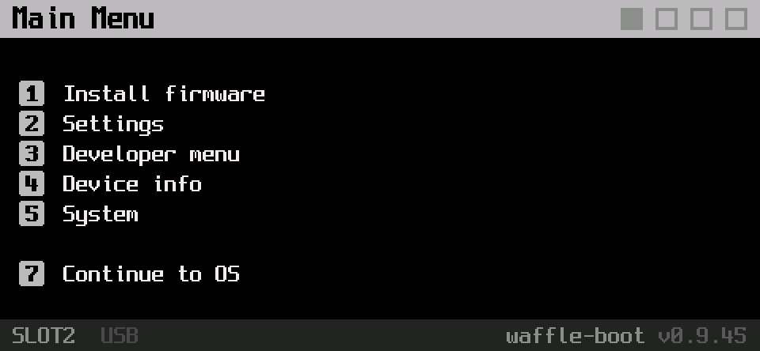

# waffle-boot

An open-source, clean-room bootloader for the Teenage Engineering OP-XY and OP-1 Field. It starts the
device's processors, loads the OS, and offers menus for installs and repairs. Support for the OP-1 Field is
initial: see [Status and Roadmap](Status-and-Roadmap). waffle-boot is independent: not
affiliated with or endorsed by Teenage Engineering, and it contains no code or data from the device's
firmware. License: GPL-2.0-or-later.

> **Status:** tested on real hardware, but not widely: use it with caution. A broken bootloader can leave a
> unit that only an external flash programmer brings back.

**The page:** <https://bagofwaffles.github.io/waffle-boot/> installs waffle-boot on an OP-XY and recovers a
unit, in Chrome or Edge over USB.

## Start here

- [How to Install](How-to-Install): put waffle-boot on a unit, step by step.
- [How to Recover](How-to-Recover): the recovery menu (Power + M4), and what to do when the unit will not
  start.

## Using a unit

- [Boot Menu](Boot-Menu): opening it, every item, the factory reset.
- [Updating the OS from the boot menu](Updating-the-OS): installing a firmware package.
- [Getting Logs Off the Unit](Getting-Logs-Off-the-Unit): system information, logs and recovery reports.
- [FAQ](FAQ), [Glossary](Glossary), [Status and Roadmap](Status-and-Roadmap).

## Reference

- [Installer Reference](Installer-Reference): what the installer writes, its checks and protocol.
- [Recovery Reference](Recovery-Reference): every recovery write, refusal and result; the host tool.
- [Boot Chain](Boot-Chain): from power-on to the OS.
- [The Front](The-Front): the first part of every image, and its failsafes.
- [Flash Layout and Write Safety](Flash-Layout-and-Write-Safety): the SPI flash's areas and every write.
- [Hardware Overview](Hardware-Overview): the processors, the PSoC, the Nordic, the flash, the eMMC.

## Developers

- [Building and Testing](Building-and-Testing): toolchain, builds, tests, local CI, the source map.
- [Test OS](Test-OS): the boot menu built as an OS image.
- [Building Custom OS Updates (.tfw)](Building-Custom-OS-Updates): a firmware package with your own OS
  image, unsigned and in plaintext.
- [Developer Host Link](Developer-Host-Link): USB requests the boot menu answers with developer mode on.
- [Screen Style Guide](Screen-Style-Guide): how the screens look and read.
- [Requirement Labels](Specification): the `S-NN.NNN` labels code and tests cite.
- [Clean-Room Rules and Contributing](Clean-Room-Rules-and-Contributing).
