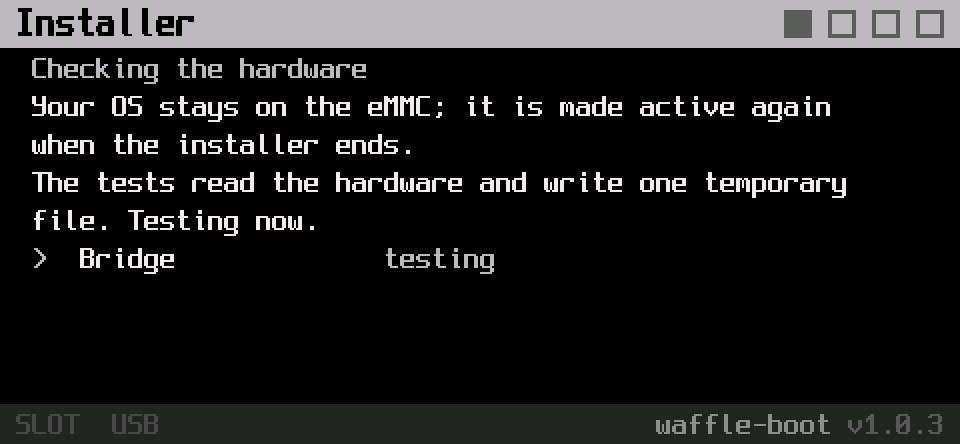
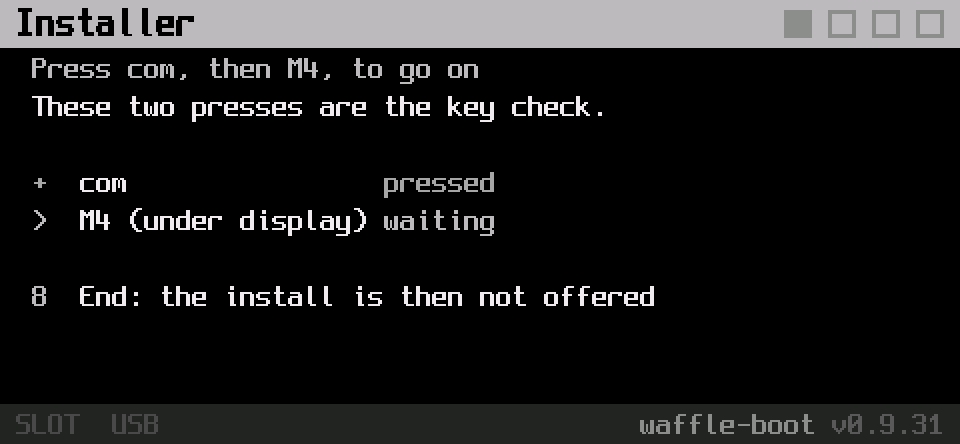
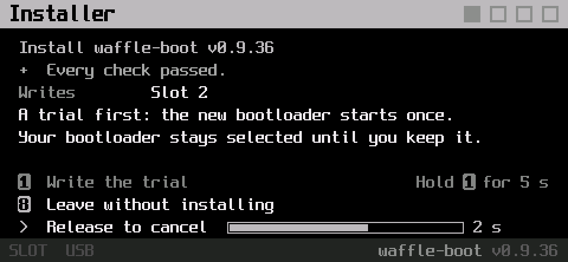
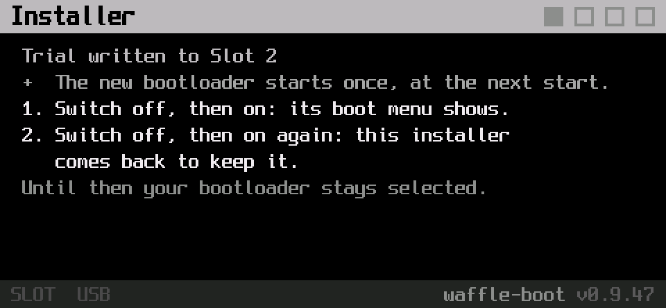
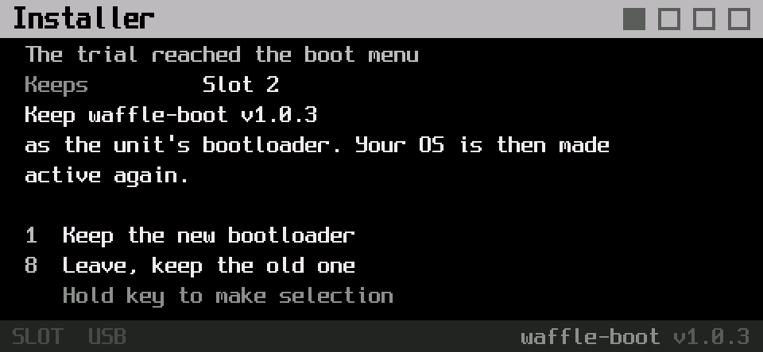
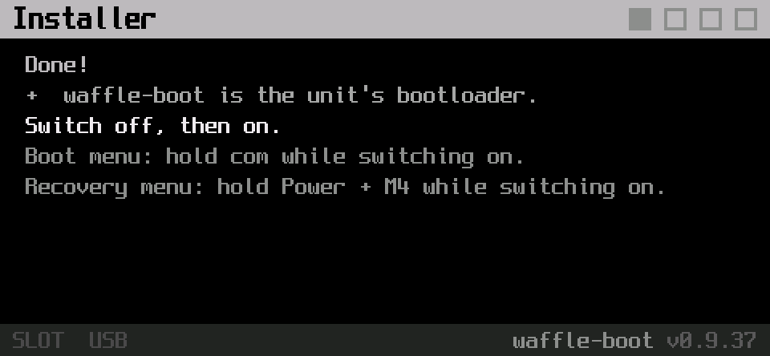

Put waffle-boot on an OP-XY with the installer, guided by [the page](https://bagofwaffles.github.io/waffle-boot/).

> **Status:** tested on real hardware, but not widely: use it with caution. A broken bootloader can leave a
> unit that only an external flash programmer brings back.

The installer is one file, `waffle-install.ldr`. It runs as the unit's OS, checks the hardware, and only
when every check passes does it offer to install waffle-boot. Every write is started on the unit: you hold
the key it names for 5 s. The page only shows what the installer reports; it sends no bootloader image and
asks for no write.

## You need

- The unit, charged, and a USB cable. Keep it on USB while it writes.
- A computer with Chrome or Edge.
- The installer file, `waffle-install.ldr`, from a waffle-boot release, or built with `make installer`
  ([Installer Reference](Installer-Reference#building-it)).
- A developer menu on the unit that writes an OS file. A unit that has never had developer mode on needs it
  turned on first, with the [ferret tool](https://bagofwaffles.github.io/ferret/op-xy/). This project does
  nothing for that step.

Your OS stays on the eMMC. The installer goes into the boot partition the OS is not in, and it makes your
OS active again when it ends.

## Steps

1. Open [the page](https://bagofwaffles.github.io/waffle-boot/) and choose **Install waffle-boot**. It
   checks the browser first.
2. Write `waffle-install.ldr` as the OS from the unit's developer menu.

   On a unit already on waffle-boot with developer mode on (Settings, 1 Developer mode), the page can send
   the file instead, over the boot menu's USB serial port: open the boot menu, connect USB, drop the file on
   the page, press **Send to the boot menu**, and pick the OP-XY (it may be named OP-XY Boot). The page
   checks the unit's copy, its size and SHA-256. Then, in the developer menu (3 on
   the boot menu), press **5**, Write /os.ldr to boot partition.
3. Switch the unit off and on. The installer starts and begins its checks.
4. Connect the unit with the USB cable. On the page, press **Connect to the installer** and pick the OP-XY.
5. Watch the checks. Each one and its result shows on the screen and on the page.

   
6. The key check: press **com**, then **M4 (4 under the display)**. 8 ends it, and the install is then not
   offered. After a trial start it is not asked again.

   
7. When every check passes, the unit shows the version it carries and the slot it will write. Hold **1** for
   5 s to write the trial. Your bootloader stays selected.

   
8. Switch off, then on. The new bootloader starts once and shows its boot menu. The page loses the port;
   that is expected.

   
9. Switch off, then on again. The installer comes back, and the page connects again.
10. The installer shows that the trial reached the boot menu. Hold **1** for 5 s to keep the new
    bootloader. Your OS is made active again.

    
11. Switch off, then on. waffle-boot starts your OS.

    

The recovery menu is now there on every start: Power + M4. See [How to Recover](How-to-Recover).

To leave at any point without installing, hold **8** for 5 s. The installer makes your OS active again.

## When something does not pass

| The unit shows | It means | What to do |
| --- | --- | --- |
| The install is not offered | A check failed or could not run, or the carried image did not pass its check. Nothing was written to the SPI flash | Save `check.txt` (on the page, or from the unit's USB disk). Hold 8 to make your OS active again. A wrong check is fixed in the installer; nothing overrides it |
| The trial did not reach the boot menu | The trial start ran, or did not run, the new bootloader, but its boot menu did not show | Nothing was kept: the unit starts the bootloader it had. Hold 1 to write the trial again, or 8 to leave |
| The write did not complete | A write or its read-back failed | The unit keeps a bootloader that starts. Hold 1 to try again, or 8 to leave |

`check.txt` lists every check. It holds no serial number or key.

## More

[Installer Reference](Installer-Reference): what each step writes, the checks, building the installer, and
its USB protocol.
