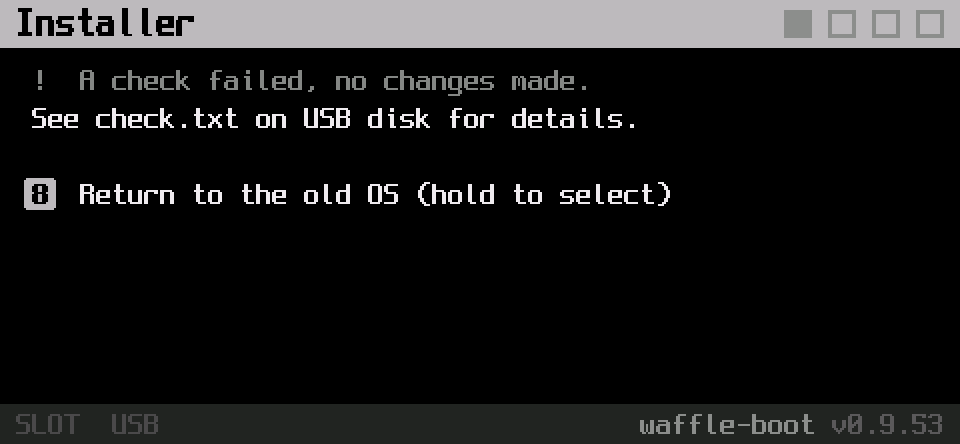

**Install with Waffle Iron: <https://bagofwaffles.github.io/waffle-iron/>**

It gets the installer onto the unit from the browser: it restarts the unit into its upload screen as a USB
disk and makes the `firmware.zip` to copy onto it, with the latest waffle-boot installer inside. The
installer then runs its checks on the unit and offers the install.

> **Back up your files first.** The OS has to be installed again afterward.

> **Status:** tested on real hardware, but not widely: use it with caution. A broken bootloader can leave a
> unit that only an external flash programmer brings back.

## You need

- The unit, charged, and a USB cable. Keep it on USB while it writes.
- A computer with Chrome or Edge.
- The OS file, to install again when waffle-boot is on the unit ([Updating the OS](Updating-the-OS)).

Every write is started on the unit: you hold the key it names (`Hold to select`). A hold takes 5 s, and
the unit shows the seconds left. The installer writes a trial first. Switch off and on: the new
bootloader starts once, its boot menu shows for a moment, and the unit comes back to the installer by
itself, which then asks whether to install. To go back to your OS at any point without installing, hold **8**
(`Return to the old OS`).

A unit that already runs waffle-boot does not need the installer: write the new image from the recovery
menu ([How to Recover](How-to-Recover#write-a-slot-from-a-computer)).

## On an OP-1 Field

The OP-1 Field (OP-1F) has initial support, from 0.9.48, run on one unit. The same installer,
`waffle-install.ldr`, can go on as the OS by the unit's own OS write, after `tools/mtpcp.py prepare-1f` has
made the volume ready for it;
that tool takes the unit's bootloader 1000.2.0 or 1000.1.1 only ([Putting the image on an OP-1F](Installer-Reference#putting-the-image-on-an-op-1f)). You
can run the survey (`waffle-install-survey.ldr`, built from the source) first: it writes nothing to the
SPI flash, and its `check.txt` says whether an install would be offered. See
[Installer Reference](Installer-Reference#on-an-op-1f).

> **One installer for both devices:** built from the current source, `waffle-install.ldr` is one image
> for the OP-XY and the OP-1F that decides the device itself. That image has not yet run on either unit.

## When something does not pass

| The unit shows | It means | What to do |
| --- | --- | --- |
| `A check failed, no changes made.` (or another reason, with `no changes made`) | A check failed or could not run, or the carried image did not pass its check. Nothing was written to the SPI flash | Save `check.txt` from the unit's USB disk. Hold 8 to return to the old OS. A wrong check is fixed in the installer; nothing overrides it |
| Trial did not reach the boot menu | The trial start ran, or did not run, the new bootloader, but its boot menu did not show | Nothing was kept: the unit starts the bootloader it had. Hold 1 to write the trial again, or 8 to return to the old OS |
| Write failed | A write or its read-back failed | The unit keeps a bootloader that starts. Hold 1 to try again, or 8 to return to the old OS |

`check.txt` lists every check. It holds no serial number or key.

## More

[Installer Reference](Installer-Reference): what each step writes, the checks, building the installer, and
its USB protocol.
