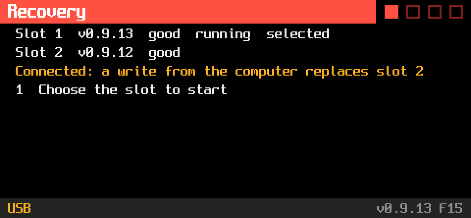
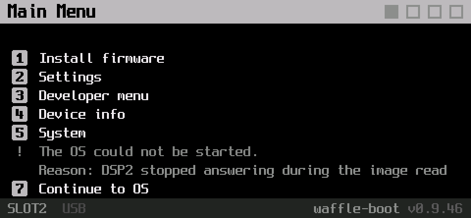
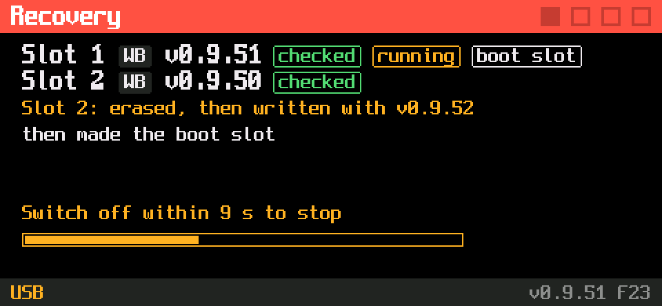

What to do when a unit on waffle-boot will not start, and how to use the recovery menu.

The recovery menu chooses which bootloader slot the unit starts, and takes a new waffle-boot image into a
slot from a computer. It lives in the front, the small first part of every image, so it runs even when the
rest is damaged. Opening it changes nothing.

## Open the recovery menu (Power + M4)

1. Switch the unit off.
2. Hold **M4 (4 under the display)**, and no other key. Switch the unit on.
3. Keep holding until the red **Recovery** screen shows, then let go of every key. Nothing acts until all
   keys are up.

It also opens by itself:

| The screen says | Why |
| --- | --- |
| `This image failed its check` | The rest of the running image is damaged |
| `Three starts in a row did not finish` | Three starts in a row ended before the boot menu or the OS came up. Quickly switching off three times during start-up does it too |

The top two lines show each slot: version, `good`, `bad`, `tried` or `tried, started`, and which one is
`running` and `selected`. In this menu, keys 1 to 4 are **M1 to M4**, and 8 is **sound key 8**. Knob clicks
and other keys do nothing.

To leave, switch off and on with no key held: the unit starts normally.

## The unit does not start

1. Connect USB power and wait a few minutes. Switch the unit off, then on, with no key held.
2. Still nothing? Switch off and on three more times. Three starts in a row that do not finish open the
   recovery menu by itself.
3. Find what you see below, and do what it says.

| What you see | What to do |
| --- | --- |
| Dark screen, on USB, switch off | The unit is only charging. Switch it on |
| The logo, then nothing, every time | Open the recovery menu and try the other slot ([below](#start-the-other-slot-once-and-keep-it)) |
| Red **Recovery** screen, `This image failed its check` | The running slot's image is damaged. Try the other slot, or [write a slot from a computer](#write-a-slot-from-a-computer) |
| Red **Recovery** screen, `Three starts in a row did not finish` | The slot starts but never comes up. Same as above. Switching off and on with no key gives it one more go |
| Boot menu: `The OS could not be started.` and a reason | Switch off and on once. If it stays, open 4 Device info for the failed step, and see [Getting Logs Off the Unit](Getting-Logs-Off-the-Unit) |
| Boot menu: `Can't start the OS: DSP2 is not answering` | The second processor stopped. Switch off and on |
| Boot menu: `OS needs reinstalling: install a TE firmware update` | The OS on the eMMC is stored in a form waffle-boot cannot load. See [Updating the OS](Updating-the-OS) |
| Boot menu: `The last install did not finish.` | Install the firmware again: [Updating the OS](Updating-the-OS) |
| Boot menu every time, no message | Settings → 6 **Start in boot menu** may be on. Turn it off, then switch off and on. Check that no key is stuck |
| Recovery keys do nothing | Use a computer: [write a slot from a computer](#write-a-slot-from-a-computer). It can do everything the keys do |
| Recovery: `Keep the power on until a write has finished` | Do not switch off. Write again from the computer until it ends well |

### When nothing appears at all

Some failures leave nothing on the unit that can start, so neither menu appears. Only an **external SPI
flash programmer**, connected to the flash chip, brings such a unit back:

- a power cut during an in-place write of the only good slot;
- a selected slot whose front fails before it reads the keys (the screen stays dark, or shows only the
  logo, and Power + M4 does nothing);
- a damaged factory first stage.

If neither the boot menu nor the recovery menu ever appears, this is likely the case. Ask for help with the
output of `python3 tools/wbrecover.py info` if you can get it, a photo of the screen, and the steps that led
here ([Getting Logs Off the Unit](Getting-Logs-Off-the-Unit)).

## Start the other slot once and keep it

Start the other slot once (a trial). If it does not come up, the next start runs the old slot.

1. Open the recovery menu.
2. Press **1** (`Choose the slot to start`), then **1** (`Try slot N once (suggested)`).
3. Read the screen. Hold **1** for 5 s until the bar is full. Letting go early cancels.
4. The screen says `Done: slot N starts once, as a trial`. Switch off and on, with no key held.
5. If slot N does not start, switch off and on again: the old slot starts.

To keep slot N after it started in its trial:

1. Open the recovery menu again.
2. Press **1**, then **3** (`Keep slot N`).
3. Hold **1** for 5 s.

Or hold M4 (4 under the display) during the trial start itself: the screen says
`Trial start of slot N: to keep it, 1, then 3`.

### Other choices (key 1 first)

| Key | Item | What it does |
| --- | --- | --- |
| 2 | `Switch to slot N for good` | Slot N starts from now on, with no trial |
| 4 | `Put slot N's record back` | Undoes a try that was not kept: slot N reads good again, nothing else changes |

Each asks you to hold 1 for 5 s. **8** goes back.

> **Warning.** Read the red lines before you confirm a switch. `Its record is bad`,
> `It is not a waffle-boot image` or `There may be no way back without a flash programmer` mean the unit may
> never start again from that slot. Try it once first (8, then 1).

## Write a slot from a computer

A write goes into the slot the unit is not running from. The running slot is not touched, so the unit still
starts if the write is interrupted.

### In a browser

You need Chrome or Edge on a computer, a USB cable, and a waffle-boot image, `waffle-boot.ldr`.

1. Open [the page](https://bagofwaffles.github.io/waffle-boot/) and choose **Recovery**, then **Guided**.
2. Open the recovery menu on the unit, and connect it with the USB cable.
3. Press **Connect to my OP-XY**, and pick **OP-XY Recovery**. The page shows what the unit reports.
4. Choose the image. The page checks it before anything is sent.
5. Tick `Replace Slot N with this image`, and press **Write the image**.
6. The unit counts down 15 s. Switching it off in that time stops the write with nothing written.

   
7. When the write is verified, press **Restart the unit**. If it does not come up, switch off and on: it
   starts the slot it ran before.

The **Advanced** tab has every command of the host tool.

### With the host tool

You need macOS or Linux, Python 3 (no other packages), a USB cable, and a git clone of this repository: the
tool checks images against the repository's own files and history. For a write, use an image built from
that clone, `build/bf703/waffle-boot.ldr` ([Building and Testing](Building-and-Testing)).

1. Open the recovery menu, and connect USB. The status bar shows `USB`, and the screen
   `Connected: a write from the computer replaces slot N`.
2. From the repository's root, see what the unit reports and what each command would do:

       python3 tools/wbrecover.py info

3. Check the file, then write it:

       python3 tools/wbrecover.py check build/bf703/waffle-boot.ldr
       python3 tools/wbrecover.py write build/bf703/waffle-boot.ldr

4. Read what the tool says it will do, and type `yes`.
5. The unit shows what it is about to write and `Switch the unit off within 15 s to stop`. Switching off or
   unplugging USB in that time stops it with nothing written. Stopping the tool does not.
6. Wait for `Verified: Slot N holds this file`. Then restart, with no key held:

       python3 tools/wbrecover.py restart

Every command is in [Recovery Reference](Recovery-Reference#the-host-tool).

## If it does not work

- **The normal start happens instead of recovery.** M4 (4 under the display) must be the only key held. Try again.
- **`Slot N holds nothing the unit can start`.** Write an image to it first, from a computer.
- **`No write: the unit cannot tell which slot is running`.** Recovery can neither write nor choose: the
  image in memory matches neither slot whole, or the flash could not be read. Restart and try again.
- **`no serial port named "OP-XY Recovery" found`, or no such port on the page.** Is the red Recovery
  screen up, and USB connected? Try another cable or port; a cable may carry power only. With the tool, or
  more than one unit, give `--port PORT`.
- **`the selector is not settled`**, or the screen says `No write yet: restart the unit once first`.
  Switch off and on with no key held, then open recovery again.
- **The screen says `Restart before another write`.** One write per visit: restart, then open recovery
  again.
- **`the port went away`, or the connection dropped.** Nothing was written mid-transfer. Reconnect and run
  the command again.
- **`Refused` or `Stopped`.** Nothing was written. The message says why.
- **`FAILED`.** Run `info`: it says what holds now and what to do. Keep the power on if the screen says so.
- **The unit does not start after a restart.** Switch it off and on with no key held. If it still does not
  start, open the recovery menu again: recovery is in every image.

The rules recovery keeps, every refusal and the protocol: [Recovery Reference](Recovery-Reference).
