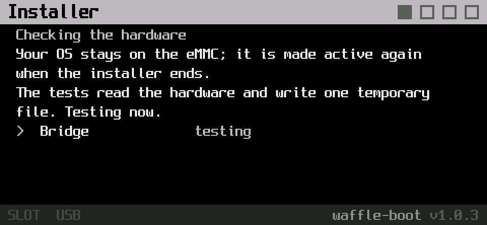
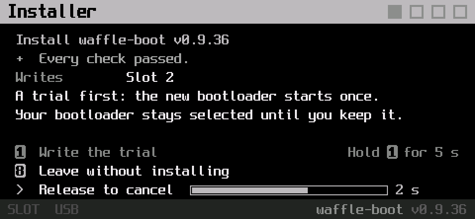
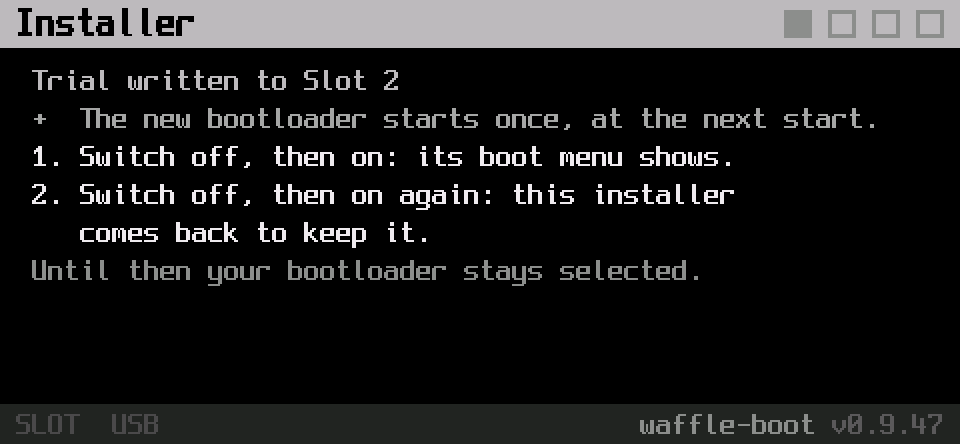
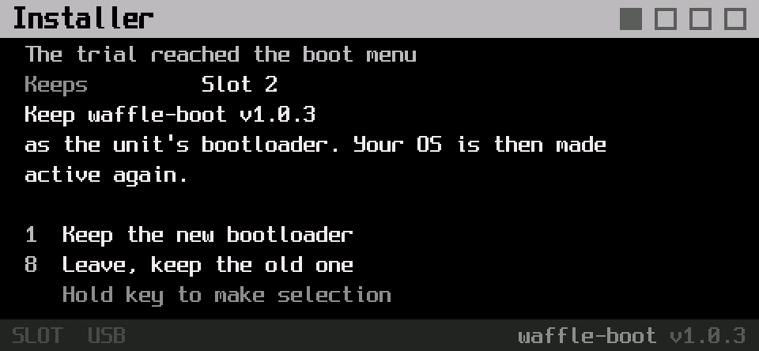
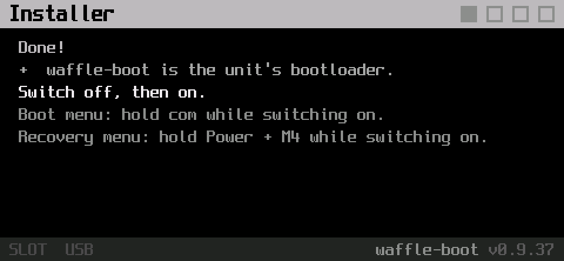
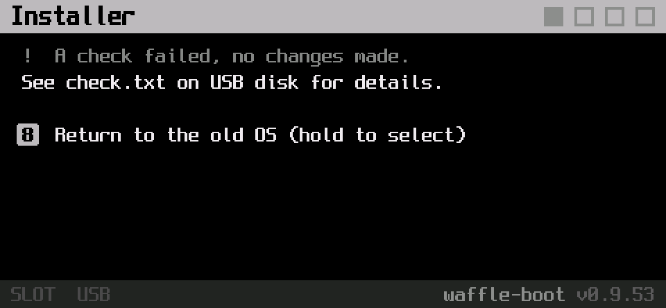

> **Under development.** The installer has not yet been run on a unit. A broken bootloader can leave a unit
> that only an external flash programmer brings back. Try it only on a unit you are prepared to lose.

The installer is one file, `waffle-install.ldr`. It runs as the unit's OS under whatever bootloader the unit
has, checks the hardware, and only when every check passes it installs waffle-boot. Every write is started
on the unit, by holding the step's key for 5 s. The [recovery page](Recover-from-a-Computer) has an
Install tab that guides each step and shows the checks as they run. To a unit already on waffle-boot it
can also send the installer file; nothing else.

## Before you start

- The bootloader on the unit needs a developer menu that writes an OS file. A unit that has never had
  developer mode on needs it turned on first, with the ferret tool.
- Your OS stays on the eMMC: the installer goes into the other boot partition, and makes your OS active
  again when it ends.
- Charge the unit, and keep it on USB.

## The steps

1. Write `waffle-install.ldr` from the developer menu, then switch off and on. On a unit already on
   waffle-boot with developer mode on, the recovery page can send the file over the boot menu's USB serial
   port and check it; then press 5 in the developer menu, Write /os.ldr to boot partition.
2. The checks run, then the key check: press com, then M4 (4 under the display). 8 ends it, and the install is not offered.
   After a trial start it is not asked again. Results are on the screen, on the page, and in `check.txt`
   on the unit's USB disk.

   
3. When every check passes, hold **1** for 5 s to write the trial. Your bootloader stays selected.

   
4. Switch off, then on: the new bootloader starts once and shows its boot menu. Switch off, then on again:
   the installer comes back.

   
5. Hold **1** for 5 s to keep the new bootloader. Your OS is made active again.

   
6. Switch off, then on: waffle-boot starts your OS. The [Recovery Menu](Recovery-Menu) is Power + M4.

   

Holding **8** for 5 s leaves without installing and makes your OS active again.

## When something does not pass

- **The install is not offered:** a check failed or could not run. Nothing was written to the SPI flash.
  Read `check.txt`, then hold 8. A wrong check is fixed in the installer; nothing overrides it.

  
- **The trial did not reach the boot menu:** nothing was kept. Hold 1 to try again, or 8 to leave.
- **The write did not complete:** the unit keeps a bootloader that starts. Hold 1 to try again, or 8 to
  leave.

## Read more

[`docs/install.md`](../blob/main/docs/install.md): what each step writes, and the installer's USB protocol.
