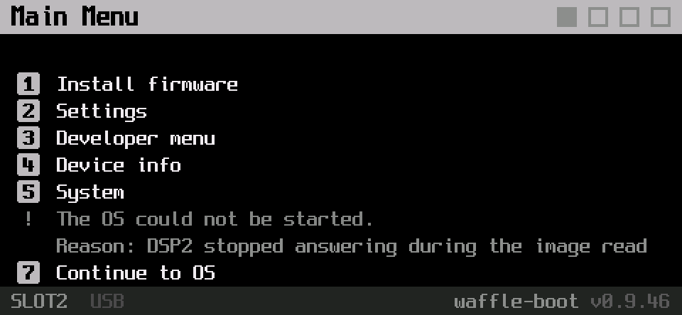

Find what you see, then follow the action. Try the first row's steps before anything else.

**You need:** the unit, and a USB cable to charge it.

## First steps

1. Connect USB power and wait a few minutes. Switch the unit off, then on, with no key held.
2. Still nothing? Switch off and on three more times. Three starts in a row that do not finish open the
   recovery menu by itself.

## What you see

| What you see | What to do |
| --- | --- |
| Dark screen, on USB, switch off | The unit is only charging. Switch it on |
| The logo, then nothing, every time | Open the [Recovery Menu](Recovery-Menu) (hold M4, switch on) and **Try** the other slot |
| Red **Recovery** screen, `This image failed its check` | The running slot's image is damaged. **Try** the other slot, or write a new image: [Recover from a Computer](Recover-from-a-Computer) |
| Red **Recovery** screen, `Three starts in a row did not finish` | The slot starts but never comes up. Same as above. Switching off and on with no key gives it one more go |
| Boot menu: `The OS could not be started.` and a reason | Switch off and on once. If it stays, open 4 Device info for the failed step, and see [Getting Logs Off the Unit](Getting-Logs-Off-the-Unit) |
| Boot menu: `Can't start the OS: DSP2 is not answering` | The second processor stopped. Switch off and on |
| Boot menu: `OS needs reinstalling: install a TE firmware update` | The OS on the eMMC is stored in a form waffle-boot cannot load. See [Installing Firmware](Installing-Firmware) |
| Boot menu: `The last install did not finish.` | Install the firmware again: [Installing Firmware](Installing-Firmware) |
| Boot menu every time, no message | Settings → 6 **Start in boot menu** may be on. Turn it off, then switch off and on. Check that no key is stuck |
| Recovery keys do nothing | Use the computer: [Recover from a Computer](Recover-from-a-Computer) |
| Recovery: `Keep the power on until a write has finished` | Do not switch off. Write again from the computer until it ends well |

## What cannot be fixed without hardware tools

Some failures leave nothing on the unit that can start, so neither menu appears. Only an **external SPI
flash programmer**, connected to the flash chip, brings such a unit back:

- a power cut during an in-place write of the only good slot;
- a selected slot whose front fails before it reads the keys (the screen stays dark, or shows only the
  logo, and Power + M4 does nothing);
- a damaged factory first stage.

If neither the boot menu nor the recovery menu ever appears, this is likely the case.

## If it does not work

Ask for help with the output of `python3 tools/wbrecover.py info`, a photo of the screen, and the steps
that led here. See [Getting Logs Off the Unit](Getting-Logs-Off-the-Unit).
