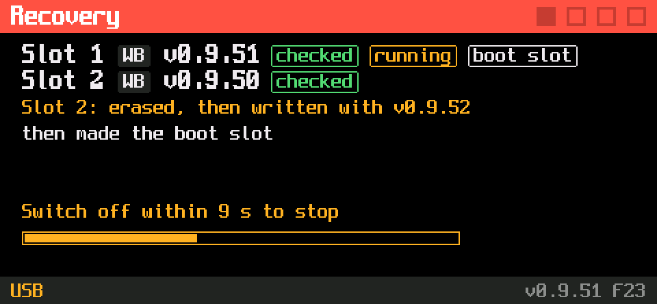

Write a waffle-boot image into a slot over USB, or choose the slot to start, with `tools/wbrecover.py`.
It does everything the [Recovery Menu](Recovery-Menu)'s keys do, so it also works when the keys do not.

**You need:**

- macOS or Linux, Python 3 (no other packages), a USB cable.
- A git clone of this repository: the tool checks images against the repository's own files and history.
- For a write, an image built from that clone: `build/bf703/waffle-boot.ldr`
  ([Building and Testing](Building-and-Testing)).

## Steps

1. Open the recovery menu: hold **M4**, switch on, let go ([Recovery Menu](Recovery-Menu)).
2. Connect USB. The status bar shows `USB`, and the screen
   `Connected: a write from the computer replaces slot N`.
3. From the repository's root, see what the unit reports and what each command would do:

       python3 tools/wbrecover.py info

4. Check the file, then write it to the slot the unit does not run from:

       python3 tools/wbrecover.py check build/bf703/waffle-boot.ldr
       python3 tools/wbrecover.py write build/bf703/waffle-boot.ldr

5. Read what the tool says it will do, and type `yes`.
6. **The countdown.** The unit shows what it is about to write and `Switch the unit off within 15 s to stop`.
   Switching off or unplugging USB in that time stops it with nothing written. Stopping the tool does not.

   

7. Wait for `Verified: Slot N holds this file`. Then restart, with no key held:

       python3 tools/wbrecover.py restart

## Commands

| Command | What it does |
| --- | --- |
| `info` | What the unit reports, and what each command would do now |
| `check IMAGE` | The file checks alone; no unit needed |
| `write IMAGE` | Write the slot the unit does not run from, and select it |
| `write --running IMAGE` | Write the slot the unit runs from |
| `write --new-front IMAGE` | An image with another front, for one trial start. Type `try the new front` |
| `try` | Start the other slot once, as a trial |
| `switch` | Start the other slot from now on. Type `switch for good` |
| `keep` | Keep a slot that was tried and started |
| `select IMAGE` | Keep the slot IMAGE was tried in, checked against IMAGE |
| `put-back` | Make a tried slot's record good again |
| `restart` | Restart the unit |

Give `--port PORT` before the command when the port is not found, or with more than one unit attached.

> **Warning.** Without `--force` the unit refuses whatever could leave it worse off. `--force` (after the
> command) lifts those refusals and asks you to type `force the <command>`. Read every line it prints first.
>
> **Danger.** `write --running` while the other slot is bad writes the only image in place. A power cut, a
> pulled cable on a flat battery, or the power switch during it leaves a unit that needs a flash programmer.
> The tool asks you to type `erase the running slot in place`. Keep the cable in until it ends.

## If it does not work

- **`no serial port named "OP-XY Recovery" found`.** Is the red Recovery screen up, and USB connected? Or
  give `--port`.
- **`the selector is not settled`**, or the screen says `No write yet: restart the unit once first`.
  Switch off and on with no key held, then open recovery again.
- **The screen says `Restart before another write`.** One write per visit: run `restart`, then open
  recovery again.
- **`the port went away`.** Nothing was written mid-transfer. Reconnect and run the command again.
- **`FAILED`.** Run `info`: it says what holds now and what to do. Keep the power on if the screen says so.
