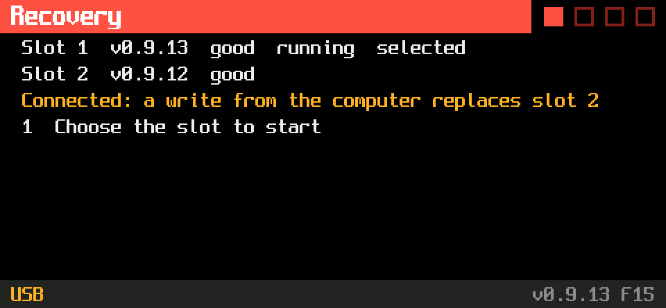

Choose which bootloader slot the unit starts, using the unit's keys alone.

**You need:** the unit, charged or on USB. In this menu, keys 1 to 4 are **M1 to M4**, and 8 is **sound
key 8**. Knob clicks and other keys do nothing.

## Open it

1. Switch the unit off.
2. Hold **M4** (4 under the display), and no other key. Switch the unit on. Keep holding until the red **Recovery** screen shows.
3. Let go of every key. Nothing acts until all keys are up.

The top two lines show each slot: version, `good`, `bad`, `tried` or `tried, started`, and which one is
`running` and `selected`. Opening the menu changes nothing. To leave, switch off and on with no key held.

## Start the other slot once (Try)

1. Press **1** (`Choose the slot to start`), then **1** (`Try slot N once (suggested)`).
2. Read the screen. Hold **1** for 5 s until the bar is full. Letting go early cancels.
3. `Done: slot N starts once, as a trial`. Switch off and on, with no key held.
4. If slot N does not start, switch off and on again: the old slot starts.

## Keep the slot you tried

After slot N started in its trial: open this menu again, press **1**, then **3** (`Keep slot N`), and hold
**1** for 5 s. Or hold M4 (4 under the display) during the trial start itself: the screen says
`Trial start of slot N: to keep it, 1, then 3`.

## Other choices (key 1 first)

| Key | Item | What it does |
| --- | --- | --- |
| 2 | `Switch to slot N for good` | Slot N starts from now on, with no trial |
| 4 | `Put slot N's record back` | Undoes a try that was not kept: slot N reads good again, nothing else changes |

Each asks you to hold 1 for 5 s. **8** goes back.

> **Warning.** Read the red lines before you confirm a switch. `Its record is bad`,
> `It is not a waffle-boot image` or `There may be no way back without a flash programmer` mean the unit may
> never start again from that slot. Try it once first (8, then 1).

## If it does not work

- **The normal start happens instead.** M4 (4 under the display) must be the only key held. Try again.
- **`Slot N holds nothing the unit can start`.** Write an image to it first:
  [Recover from a Computer](Recover-from-a-Computer).
- **`No write: the unit cannot tell which slot is running`.** Recovery can neither write nor choose: the
  image in memory matches neither slot whole, or the flash could not be read. Restart and try again.
- **Keys do nothing.** The computer can do everything the keys do:
  [Recover from a Computer](Recover-from-a-Computer).
- **The screen stays dark.** See [My Unit Will Not Start](My-Unit-Will-Not-Start).
