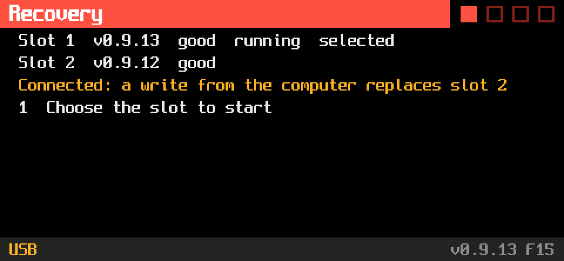

Reference for recovery in front version 15: every write, refusal and result. Step-by-step guides are in
[How to Recover](How-to-Recover); the safety rules are in [The Front](The-Front#the-failsafes). This page is
also the reference for the recovery round on a unit that a changed front needs before it is committed to a
slot ([The Front](The-Front#changing-it)).

## Starting it

| How | When |
| --- | --- |
| **Power + M4** | M4 (4 under the display) held alone while switching on (S-15.150) |
| By itself | The rest of the image fails its check |
| By itself | Three starts in a row ended before the boot menu or the OS (S-02.095). The next start is normal |

Opening recovery writes nothing to the slots (after three unfinished starts it clears one start-log bit).
Switching off or restarting leaves the unit as it was.

## The rules it keeps

- A write goes to the slot the unit is not running from, unless you ask for the running one.
- Every image is checked before anything is erased, and read back before the unit is told to start it.
- A write or action from a computer waits 15 s first; switching off then stops it with nothing written.
- On the unit, every action needs key 1 held for 5 s, after a screen that warns of the risk.
- From a computer, anything that could leave the unit worse off is refused unless forced, and forcing asks
  for a typed phrase.

Some failures leave a unit that only an external SPI flash programmer brings back. They are listed in
[Flash Layout and Write Safety](Flash-Layout-and-Write-Safety#what-is-not-safe-against-a-power-cut).

## The recovery menu

It shows each slot's version and state (`good`, `bad`, `tried`, `tried, started`), which slot runs and
which is selected, and what a write would replace. The status bar shows `USB` and the image and front
versions (`v1.0.10 F15`). No key acts until every key has been released once; an unreadable key counts as
not pressed.

### The slot menu (key 1)

N is the slot the unit does not run from. Only items that apply are shown. Key 8 goes back.

| Item | Does |
| --- | --- |
| `1  Try slot N once (suggested)` | The next start runs slot N once, then the current slot again. Writes only N's record |
| `2  Switch to slot N for good` | The unit starts slot N from now on |
| `3  Keep slot N` | For a tried slot that came up: start it from now on. In a trial start, the tried slot's own recovery offers this for itself |
| `4  Put slot N's record back` | A tried, unkept slot reads good again; also cancels a try not yet started |

**Hold key 1 for 5 s to confirm**; releasing early writes nothing. The confirm screen warns, but does not
refuse:

| Slot N | Warning |
| --- | --- |
| Good, same front | A trial first is suggested |
| Good, another front | Recovery may not open from it |
| Good, not waffle-boot | No recovery from there |
| Bad record | Nothing will check it; there may be no way back without a flash programmer |

A tried slot reads `tried` and counts as bad until kept or put back. A power cut between a record's erase
and program leaves the slot bad with its image intact: write it again, or switch to it knowing that.

## The browser page

[The page](https://bagofwaffles.github.io/waffle-boot/) does what the host tool does, from Chrome or Edge on
a computer, over Web Serial: a guided write of the slot the unit does not run from, and an Advanced tab with
every command below. It decides and says what the tool does (its tests hold it to the tool, on the front's
own code), and the unit checks every image and counts down all the same. Nothing is sent to a server. Its
developer notes are in [`docs/web/README.md`](../blob/main/docs/web/README.md).

## The host tool

`tools/wbrecover.py` (Python 3 only, no other packages) finds the port named `OP-XY Recovery` on macOS and
Linux; elsewhere, or with more than one unit, pass `--port PORT` before the command. It does everything the
keys do. It needs a git clone of this repository: it checks images against the repository's own files and
history.

Below, the running slot is the one the unit runs from, and the other slot is the one it does not.

| Command | Does | You type |
| --- | --- | --- |
| `check IMAGE.ldr` | Checks a file; no unit needed | |
| `info` | What the unit reports, and what each command would do now | |
| `write IMAGE.ldr` | Writes the other slot, and selects it | `yes` |
| `write --running IMAGE.ldr` | Writes the running slot: the other slot is selected first if good; in place if it is bad | `yes`, or `erase the running slot in place` |
| `write --new-front IMAGE.ldr` | Writes an image with another front to the other slot for one trial start; that slot's old image is lost | `try the new front` |
| `try` | Starts the other slot once, as it is | `yes` |
| `switch` | Starts the other slot from now on | `switch for good` |
| `keep` | Keeps a slot that was tried and started | `yes` |
| `select IMAGE.ldr` | Keeps the slot IMAGE was tried in, checked against IMAGE | `yes` |
| `put-back` | Makes a tried slot's record good again | `yes` |
| `restart` | Restarts the unit | |
| any, with `--force` (after the command) | Lifts the refusals that only protect you (below) | `force the <command>` |

To write a build: `make bump-version`, `make cross`, Power + M4 (4 under the display), connect USB, `info`,
then `write build/bf703/waffle-boot.ldr`. On `Verified`, `restart` or switch off and on without a key.
Restart before another write: one write per visit.

Both slots may hold the same image: every command works as with two different ones. Recovery then counts
as the running slot the one the unit goes on starting, which is the one the selector names when it is
trusted or good; the boot menu's status bar names the same slot. A front before version 14 refuses the
image a slot already holds, and refuses every write while both slots hold the same image; the tool says so
before sending.

### Limits

- An image is at most `0x77000` bytes (the last sector is the start log). Over `0x76000` the tool warns: in
  Slot 2 it switches off the stored boot settings (S-02.096 to S-02.100). A smaller image leaves them as
  they are.
- The file must be a stream the boot ROM can start (S-02.091), with a waffle-boot front whose pin is its
  own and matches the unit's (else `--new-front`). The tool compares the read-back with the file afterwards.

### The countdown

After accepting `write`, `try`, `switch`, `keep`, `select` or `put-back`, the unit shows
`Switch the unit off within 15 s to stop`. **Switching off or unplugging USB then leaves the flash
untouched.** Stopping the tool does not stop it. `info`, `restart` and repair writes after a failed write
of the running slot have no countdown.

### Warnings

- **`write --running` with the other slot bad writes the running slot in place, with no fallback.** It is
  refused until a plain `write` of the other slot has failed in this recovery (or `--force`). A power cut, a
  pulled cable with a flat battery, or the power switch during it leaves a unit only a flash programmer can
  repair. The tool shows the battery; the unit holds off the power switch and answers only status requests
  until the write ends. Keep the cable in until it ends.
- `write --running` with the other slot good: an interruption starts the other slot. If it is not
  waffle-boot, the unit is then without this recovery.
- **After a failed write of the running slot**, the unit re-reads the flash before every answer and `info`
  says which write each command would make. Writes start without a countdown and settle the selector on the
  slot written. Until a start would reach a good slot, the screen says
  `Keep the power on until a write has finished`, the power switch is held off and `restart` is refused
  (unless forced). Keep the cable in.
- **A new front**: the next start runs the other slot once and the selector returns to the running slot. If
  it does not come up, switch off and on. To keep it after its trial start: key 1 then `3`, `keep`, or
  `select IMAGE.ldr`, or hold M4 (4 under the display) through the trial start and keep it from its own
  recovery. Not covered: a front that starts once and fails later, and, with the other slot as Slot 2, a
  power cut in the selector erase at the end of the write or the first instant of the trial start. The same
  holds for `try`.

Read every line the tool prints before you type a phrase.

### `--force`

Lifts, on `write`, `select`, `try`, `switch`, `keep` and `restart`: another front with no trial; an image
with no waffle-boot front; an in-place write of the running slot before a write of the other slot failed; a
write with the selector unsettled or naming the other slot (only while that slot is good); a keep of a slot
that has not started; a try of or switch to a bad slot; a restart while no start would reach a good slot.

Never lifted: a damaged, too large or unbootable image; a flash operation that failed or did not read back;
a unit that cannot tell which slot it runs from; a write of the running slot while the selector names a bad
slot; a switch to a slot with nothing the boot ROM can start.

## Results

| Result | What to do |
| --- | --- |
| **Verified** / `Done` | `restart`, or switch off and on without a key |
| **Refused**, **Stopped** | Nothing was written; follow the message |
| The port went away mid-transfer | Nothing was written; run the command again |
| **FAILED** writing the other slot, the running slot intact | The unit starts as before; run `write` again |
| **FAILED** writing the running slot, or it is damaged | Run `info` (see the warnings above) |
| No answer | Replug USB. If the screen is gone and no write of the running slot failed, Power + M4 (4 under the display) again. During an in-place write, wait, then `info` |

## Protocol

`tools/wbrecover.py` is the reference host; `src/front/fr_proto.h` gives every offset. Recovery is a
USB serial (CDC) port with the product string `OP-XY Recovery` (vendor `0x2367`, product `0x0021`).

A frame is `"WR"`, a type byte, a sequence byte, a little-endian u16 payload length (at most 1032), the
payload, and a little-endian CRC-32 (zlib's) over type, sequence, length and payload. Integers are
little-endian. The host asks; the unit answers each request with `type | 0x80` and the same sequence
number. Bytes that do not form a valid frame are dropped up to the next `"WR"`. The host uses a new
sequence number for every attempt, so a late reply cannot be taken for the current one.

| Type | Request | Reply |
| --- | --- | --- |
| `0x01` HELLO | empty | 47 bytes: protocol version (2), front version, largest DATA (1024), why recovery runs, flags, the running image's version and front pin |
| `0x02` INFO | empty | 232 bytes: everything the screen shows, both slots, the write's phase and progress, the battery, the countdown |
| `0x03` BEGIN | u32 length, SHA-256, optional flags byte | status, the way the write will go, the target slot |
| `0x04` DATA | u32 offset, 1 to 1024 image bytes | status, the next offset |
| `0x05` END | empty | status, the image check's result; the write follows the countdown |
| `0x06` RESTART | empty, or a flags byte | status, then the unit restarts |
| `0x07` ACT | action (1 try, 2 switch, 3 keep, 4 put back), flags | status, the way, the slot, the slot's tier |

BEGIN's flags: `0x01` write the running slot, `0x02` a new front for a trial, `0x04` select the slot that
holds the image as tried (at most one of these), and `0x80` force. ACT and RESTART take only `0x80`.

Every reply but HELLO and INFO starts with a status byte: 0 is accepted, low values are the write's
results (as `wbrecover.py` lists them), and `0x40` malformed or unknown request, `0x41` not now, `0x42`
DATA not at the next offset, `0x43` END before every byte came or DATA past the end, `0x44` restart
refused. While a write runs, only HELLO and INFO are served; the rest are answered busy. An image is 1 to
`0x77000` bytes, sent in order. After an accepted END or ACT the unit counts down 15 s before its first
erase; the host leaving the port in that time, or during a transfer, stops it with nothing written. Poll
INFO to follow a write to its end.

## When recovery will not write

| Reason | What to do |
| --- | --- |
| The running slot is not selected, or the selector is not settled | Restart once without a key, then Power + M4 (4 under the display); or `--force` |
| The selected slot is bad and its front not intact | Key 1, choose the slot to start; or `try` / `switch` |
| Not a slot image with a front, or over `0x77000` bytes | Use the image from `make cross` |
| `--running` in place before a plain `write` failed | Run a plain `write` first |
| A read failed, the unit's state changed, or the file arrived damaged | `info`, then try again |
