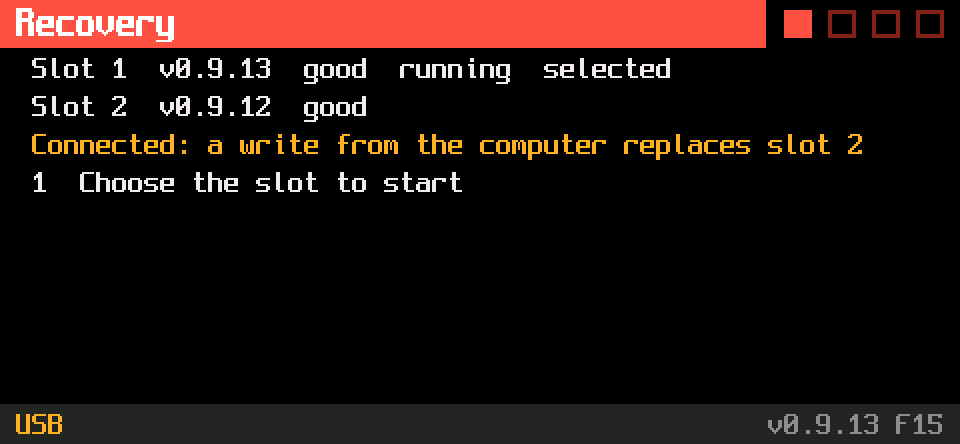

Recovery chooses which bootloader slot the unit starts, and writes a new waffle-boot image into a slot. It
lives in the front, the small first part of every image, so it runs even when the rest is damaged.

## Which guide

| You want to | Guide |
| --- | --- |
| Find out why the unit does not start | [My Unit Will Not Start](My-Unit-Will-Not-Start) |
| Start the other slot, once or for good, with the unit's keys | [Recovery Menu](Recovery-Menu) |
| Write a new image, or do the same from a computer | [Recover from a Computer](Recover-from-a-Computer) |

## How recovery opens

| How | When |
| --- | --- |
| **Power + M4** | Hold M4 (4 under the display), and no other key, while you switch the unit on |
| By itself, `This image failed its check` | The rest of the running image is damaged |
| By itself, `Three starts in a row did not finish` | Three starts in a row ended before the boot menu or the OS came up |

Opening recovery writes nothing to the slots. Switching off and on with no key held starts normally.

## The rules it keeps

- A write goes to the slot the unit is not running from, unless you ask for the running one.
- Every image is checked before anything is erased, and read back before the unit is told to start it.
- A write or action from a computer waits 15 s first; switching off then stops it with nothing written.
- On the unit, every action needs key 1 held for 5 s, after a screen that warns of the risk.
- From a computer, anything that could leave the unit worse off is refused unless forced, and forcing asks
  for a typed phrase.

Some failures leave a unit that only an external SPI flash programmer brings back. They are listed in
[Flash Layout and Write Safety](Flash-Layout-and-Write-Safety).

## Read more

[`docs/recovery.md`](../blob/main/docs/recovery.md): every write, refusal and result in full.
