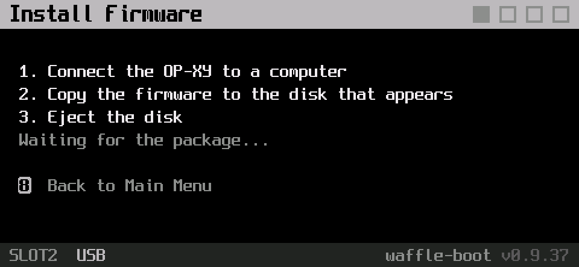
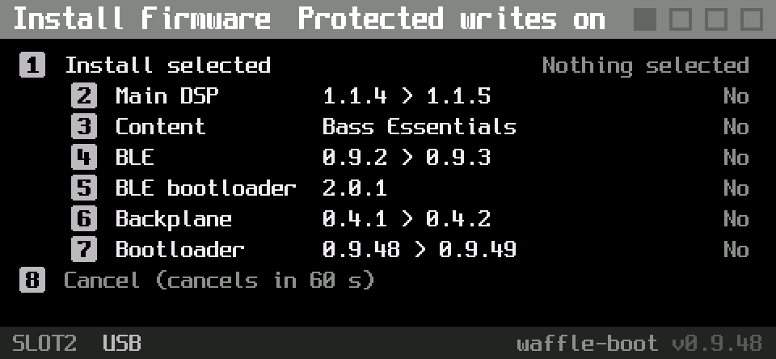

Updating the OS from the boot menu: install a TE firmware package (content and OS) on a unit that runs
waffle-boot. To install waffle-boot itself, see [How to Install](How-to-Install).

## What can be installed

| Task | Status |
| --- | --- |
| Install a TE firmware package (content and OS) from the boot menu | Tested on one unit |
| Install waffle-boot | [How to Install](How-to-Install) |
| Replace waffle-boot in one slot with another waffle-boot build | [How to Recover](How-to-Recover#write-a-slot-from-a-computer) |
| Update the Bluetooth (BLE) chip, its bootloader, or the backplane (PSoC) | **Not tested on a unit.** Choose them on the list as any part |
| Return to the factory bootloader | **Not supported yet** |
| Build a package with your own OS image | Developers: [Building Custom OS Updates (.tfw)](Building-Custom-OS-Updates) |
| Write an OS image file directly | Developers: Boot menu → Developer menu → 5 ([Test OS](Test-OS#loading-it)) |

## Steps

You need a USB cable, a computer, and the firmware package file (its name contains `tfw`).

1. Open the [Boot Menu](Boot-Menu) and press **1** (**Install firmware**).
2. A disk appears on the computer. Copy the package file to the disk's top folder.
3. Eject the disk. After a short wait the unit checks and unpacks the package, then lists its parts.
4. Choose the parts to install: each part's digit switches it between `No` and `Yes`. Every part starts at
   `No`. Then hold **1** for 5 s. **8**, or 60 s with no key, cancels: nothing is installed. Then **8** goes
   back to the boot menu and **6** restarts; you can also copy the package to the disk again.
5. Do not switch off while it runs. Steps show as `Installed`, `Not included` or `Skipped`.
6. At `Done!`, press **6** to restart into the OS, or switch off and on.

| Digit | Part |
| --- | --- |
| 2 | Main DSP (the OS) |
| 3 | Content |
| 4 | BLE |
| 5 | BLE bootloader |
| 6 | Backplane |
| 7 | Bootloader |

A part the package does not carry has no row; the others keep their digits. A row shows the installed
version and the package's (`1.1.4 > 1.1.5`), or the package's alone. A gray row cannot be chosen, and says
why: `Protected writes off`, `Up to date` (the BLE, BLE bootloader or backplane version on the unit is the
package's), or `Not in this version` (a build that switches a step off). A part left at `No` shows
`Skipped: not selected` and is not touched. The unit asks again at every install; nothing is remembered. If
the unit cannot read its keys, it shows no list and installs every part it can but the bootloader, the BLE and
backplane parts included.

With **Protected writes** off (the default), the bootloader cannot be chosen: an install writes content and
the OS only, and never touches the bootloader or the first stage.

> **Warning.** With Protected writes on, choosing **7 Bootloader** writes the package's bootloader into a
> slot in place of waffle-boot; the list says which slot. A package's first stage is never looked at or
> written.

## If it does not work

| Message | Meaning |
| --- | --- |
| `No valid package found` | No file with `tfw` in its name in the disk's top folder, or the package was refused. The reason line says why ([the reasons](Building-Custom-OS-Updates#refusal-reasons)) |
| `Nothing was installed.` after the list | The list was canceled with 8 or ran out of time. Copy the package to the disk again, press **8** to go back, or **6** to restart |
| `Upgrade failed.` or `Installation failed.` | A step failed; its row says which. Switch off and on, then install again |
| `The last install did not finish.` | The unit stopped mid-install. Install the same package again |
| `Bootloader  Skipped: written, runs on restart` | The same package was installed again before a restart: its bootloader is already in the other slot and starts after the next restart |
| `OS needs reinstalling: install a TE firmware update` | The OS on the eMMC is stored encrypted, which waffle-boot cannot load. An install of the OS writes it in a form it can |
